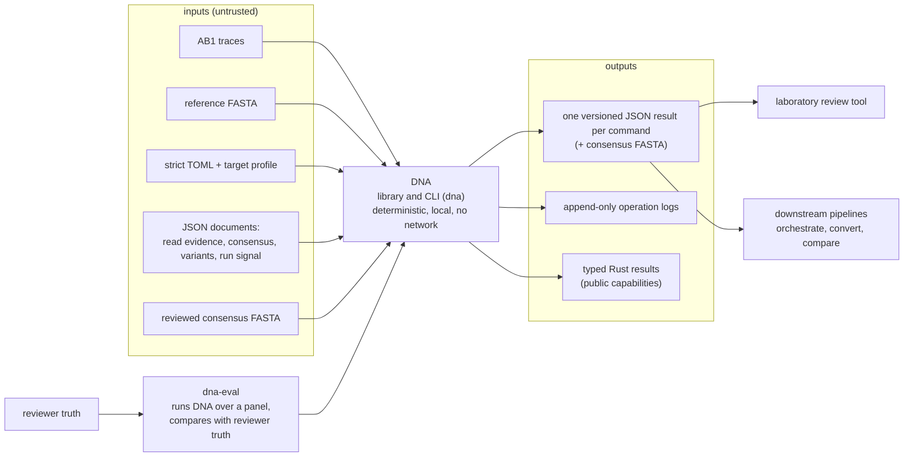

# System Context

DNA is a local scientific Rust library and CLI for DNA analysis.

The current production capability processes Sanger sequencing traces stored as
ABIF. The platform architecture is intentionally broader than that implementation
and is not restricted to mitochondrial DNA.

## Context diagram

## Platform scope

DNA separates four orthogonal concerns:

- **biological target** — for example mitochondrial DNA, nuclear/genomic DNA, or
  targeted loci/panels;
- **sequencing modality** — currently Sanger traces and reviewed consensus
  sequences, with NGS as a future modality;
- **external format** — for example ABIF, FASTA/FASTQ, BAM/CRAM, or VCF/BCF;
- **analysis capability** — for example base calling, alignment/mapping, variant
  analysis, SNP/genotyping analysis, haplogroup, or nomenclature.

SNP is therefore an analysis target/variant class rather than another sequencing
modality.

## Current production inputs

- Sanger sequencing traces encoded as ABIF (commonly named `.ab1`);
- reviewed consensus sequences in FASTA, one record per read (`call`);
- recorded contract documents that replay a later step without the traces:
  `dna.read_evidence/v1` (`analyze --evidence`), `dna.consensus/v1` (`call`), and
  `dna.signal/v1` (`review --signal`);
- `dna.variants/v1` documents for post-calling notation (`notation`);
- one short FASTA reference for reference-guided operations;
- strict TOML configuration and the target profile it names;
- explicit sample identifiers and trace paths for sample aggregation.

Future formats or modalities are not production behavior until their own
requirements, adapters, validation, and public contracts are implemented.

## External outputs

- one versioned command-specific JSON result per successful core invocation;
- typed Rust results for public library capabilities;
- separate append-only operational logs;
- downstream pipelines orchestrate runs and group, convert, and compare outputs
  (ADR-0065, ADR-0066); the `dna` binary and library do none of that. The
  evaluation harness `dna-eval`, a separate workspace binary, runs DNA over
  test panels and compares with reviewer truth as validation evidence
  (ADR-0075).

## Trust boundary

Input bytes, paths, filenames, manifests, configuration, future HTS records, and
external scientific data are untrusted. Sensitive biological data is governed by
[[governance/data|data policy]] and [security](../security/README.md).

The core is not a network service and currently has no deployment topology. A
deployment document should be added only if a real deployed runtime boundary is
introduced.
