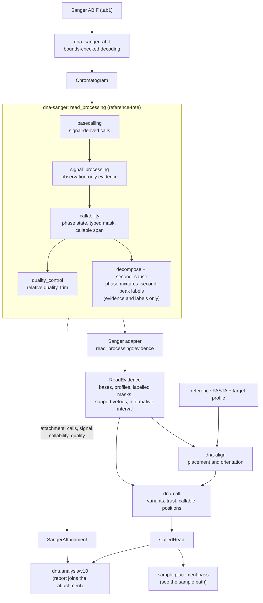
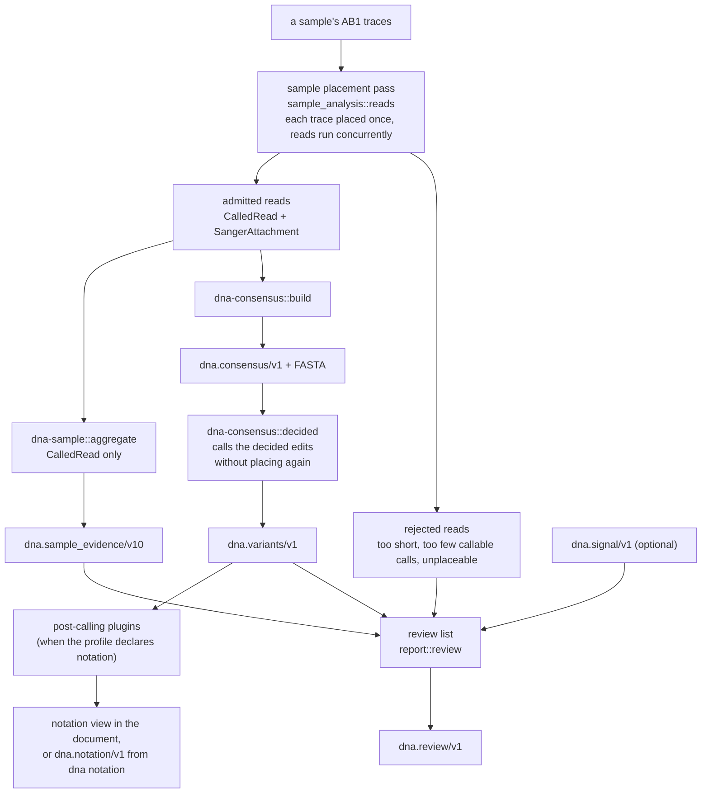
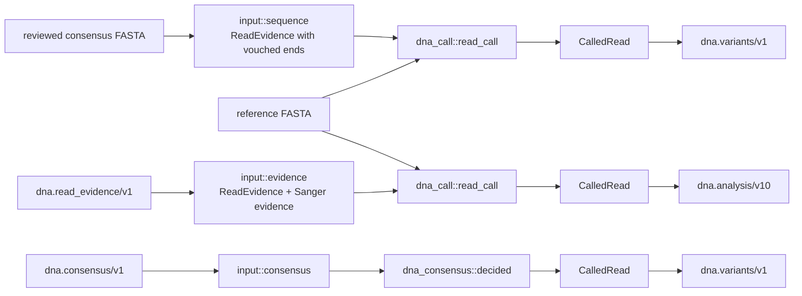
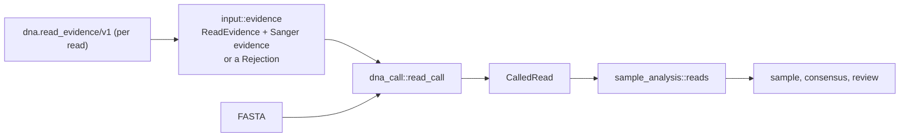
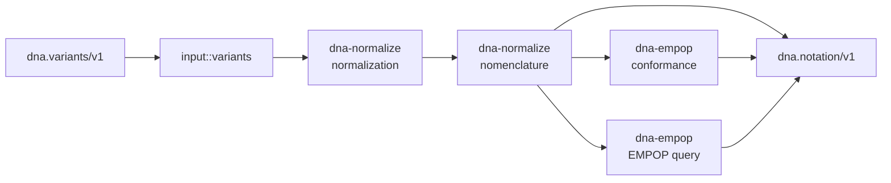
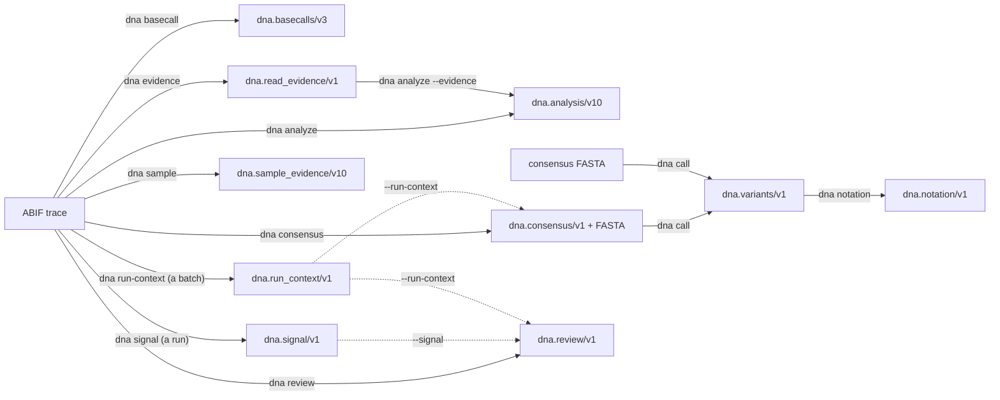
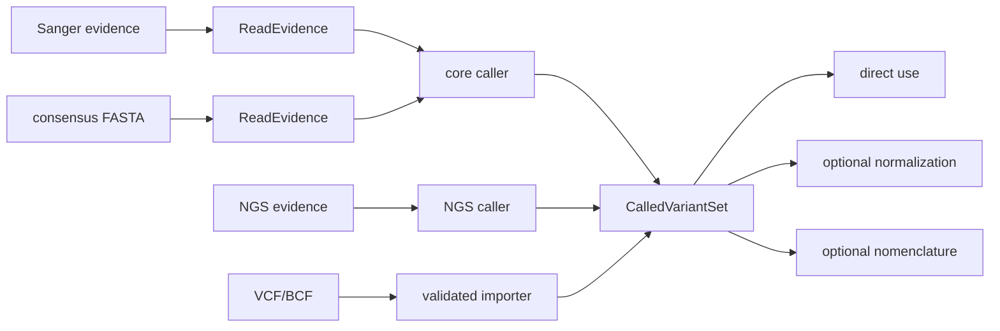

# Data Flow

## Current Sanger production path

One read, from ABIF bytes to a called read. The diagram is the whole path of
`dna analyze`; `dna basecall` stops after read processing and `dna evidence`
after the Sanger adapter.

A sample places every trace once; the sample evidence, the consensus, and the
review all start from that pass.

Other entries reach the same core without the traces:

A read's evidence document replays its placement and per-read calling
without the trace (SRS-API-018), and a sample's documents replay the sample
commands (SRS-API-019); a document of a read the Sanger plugin set aside
carries its rejection instead:

A variants document reaches the post-calling plugins in another process
(`dna notation`):

`variant_analysis::observation` owns the authoritative reference-guided
single-read scientific path. The public Rust Variant Analysis capability, CLI
analysis, and sample processing reuse that path rather than owning duplicate
implementations; analysis from a read evidence document reuses its core call
(`observation::call`) and the single Sanger projection of the facade's
model (`SangerRead`), so both analyze paths build the document the same way.
Sample processing is one pass, `sample_analysis::reads`, that places each
read once, from its trace or from its evidence document; the sample evidence
and the consensus both start from it, in the `sample`, `consensus`, and
`review` commands and in the public Sample Analysis capability alike. Every
sample document reads a read's Sanger evidence through `SangerRead` and a
rejected read through `Rejection`, which the trace path projects and the
evidence path reads back, so both build the documents the same way.

Alignment and variant calling see the read only as `ReadEvidence`
([[ADR-0069]]):
the Sanger adapter turns calls, signal, callability, and quality into bases,
profiles, labelled masks, support vetoes, and the informative interval.

Completed typed scientific state is projected by the report layer and serialized
before atomic no-overwrite CLI publication. Logging remains operational side
evidence rather than part of deterministic scientific result contracts.

## Step contracts

Each step's output is a versioned contract that can be checked on its own
([PROP-0011](../proposals/0011-step-contracts.md)). The facade serializes every
contract; the crate computes what it holds. Each crate's source README names
its output contract, and `validate_docs_structure.py` checks that the named
schema exists.

| Step (crate) | Input contract(s) | Output contract | Command | Schema |
|---|---|---|---|---|
| shared contracts ([dna-kernel](../../crates/dna-kernel/src/README.md)) | — | none: no step; `dna.read_evidence/v1` serializes its `ReadEvidence` | — | — |
| read processing ([dna-sanger](../../crates/dna-sanger/src/README.md)) | ABIF trace | `dna.basecalls/v3` | `dna basecall` | [basecalls-v3](../reference/schemas/basecalls-v3.schema.json) |
| per-call evidence ([dna-sanger](../../crates/dna-sanger/src/README.md) → `ReadEvidence`, phase mixtures by [dna-trace](../../crates/dna-trace/src/README.md)) | ABIF trace | `dna.read_evidence/v1` | `dna evidence` | [read-evidence-v1](../reference/schemas/read-evidence-v1.schema.json) |
| run signal ([dna-sanger](../../crates/dna-sanger/src/README.md) `run_signal`) | a run's ABIF traces | `dna.signal/v1` | `dna signal` | [signal-v1](../reference/schemas/signal-v1.schema.json) |
| placement ([dna-align](../../crates/dna-align/src/README.md)) | `dna.read_evidence/v1` (in process from a trace, or the file with `--evidence`), reference FASTA | `dna.analysis/v10` `alignment` and each call's `column` | `dna analyze`, `dna analyze --evidence` | [analysis-v10](../reference/schemas/analysis-v10.schema.json) |
| placed reads ([dna-align](../../crates/dna-align/src/README.md) `placed`, [[ADR-0087]], proposed) | `dna.read_evidence/v1`, reference FASTA | `dna.placed_read/v1` | none yet; `dna-eval`'s placement cache (`dna::recorded::placed_read_document`) | [placed-read-v1](../reference/schemas/placed-read-v1.schema.json) |
| read assertion ([dna-call](../../crates/dna-call/src/README.md)) | `dna.read_evidence/v1` (in process or the file), `dna.analysis/v10` `alignment` | `dna.analysis/v10` `variants` and each call's `trust`; component calls: none yet ([PROP-0010](../proposals/0010-length-mixture-decomposition.md)) | `dna analyze`, `dna analyze --evidence` | [analysis-v10](../reference/schemas/analysis-v10.schema.json) |
| read assertion over reviewed sequences ([dna-call](../../crates/dna-call/src/README.md), facade `input::sequence`) | consensus FASTA | `dna.variants/v1` | `dna call <FASTA>...` | [variants-v1](../reference/schemas/variants-v1.schema.json) |
| sample evidence ([dna-sample](../../crates/dna-sample/src/README.md)) | the reads' `dna.read_evidence/v1` (in process from the traces, or the files with `--evidence`), reference FASTA | `dna.sample_evidence/v10` | `dna sample`, `dna sample --evidence` | [sample-evidence-v10](../reference/schemas/sample-evidence-v10.schema.json) |
| run context ([dna-consensus](../../crates/dna-consensus/src/README.md) `noise`, assembled by the facade, [[PROP-0014]]) | a batch's reads (traces or `dna.read_evidence/v1`), reference FASTA | `dna.run_context/v1` | `dna run-context` | [run-context-v1](../reference/schemas/run-context-v1.schema.json) |
| consensus ([dna-consensus](../../crates/dna-consensus/src/README.md) `build`) | the reads' `dna.read_evidence/v1` (in process or the files), reference FASTA | `dna.consensus/v1` and its FASTA | `dna consensus`, `dna consensus --evidence` | [consensus-v1](../reference/schemas/consensus-v1.schema.json) |
| decided calls ([dna-consensus](../../crates/dna-consensus/src/README.md) `decided`) | `dna.consensus/v1` | `dna.variants/v1` | `dna call <consensus.json>` | [variants-v1](../reference/schemas/variants-v1.schema.json) |
| normalization and nomenclature ([dna-normalize](../../crates/dna-normalize/src/README.md)) | `dna.variants/v1` | `dna.notation/v1` `notation` | `dna notation` | [notation-v1](../reference/schemas/notation-v1.schema.json) |
| conformance and EMPOP query ([dna-empop](../../crates/dna-empop/src/README.md)) | `dna.variants/v1`, as represented | `dna.notation/v1` `conformance`, `empop` | `dna notation` | [notation-v1](../reference/schemas/notation-v1.schema.json) |
| review (facade [report](../../src/report/README.md) [`review`](../../src/report/review/README.md)) | the reads' `dna.read_evidence/v1` (in process or the files), reference FASTA, optional `dna.signal/v1`; the sample's analysis and call in process | `dna.review/v1` | `dna review`, `dna review --evidence` | [review-v1](../reference/schemas/review-v1.schema.json) |
| evaluation ([dna-eval](../../crates/dna-eval/src/README.md)) | panel manifest, reviewer truth, ABIF traces; optionally the evidence cache's documents and forms index (`--evidence-cache`) | `dna.eval_run/v1`: `run.json` and the TSV tables of the run directory | `dna-eval run` | [eval-run-v1](../reference/schemas/eval-run-v1.schema.json) |
| regression check ([dna-eval](../../crates/dna-eval/src/README.md) `regress`) | the regression set's manifest, reviewer truth, ABIF traces, the ledger head, an intent file | `dna.eval_regress/v1`: `golden.tsv`, `changes.tsv`, `regress.md`, `run.json` | `dna-eval regress check` | [eval-regress-v1](../reference/schemas/eval-regress-v1.schema.json) |

When the profile declares notation, `dna sample` and `dna call` also carry
dna-normalize's `notation` in their documents.

A contract the next step reads can replay that step without the traces
([PROP-0011](../proposals/0011-step-contracts.md)): `dna analyze --evidence`
places and calls a read from its `dna.read_evidence/v1` file, which carries
everything the core and the analysis document need, and writes the analysis
byte-identical to `dna analyze <trace>` (SRS-API-018). `dna sample`,
`dna consensus`, and `dna review` with `--evidence` start from a sample's
documents, rejected reads included, and write their documents byte-identical
to the trace-based commands (SRS-API-019).

## Platform direction

Future modalities keep source-specific evidence until a biological difference
has actually been called or imported. The common convergence point is
`CalledVariantSet`, not a universal raw-alignment object.

The source-specific paths are intentionally different:

| Source | Path to called variants |
|---|---|
| Sanger ABIF | chromatogram -> base calling/signal/callability/QC -> `ReadEvidence` -> core caller (implemented) |
| consensus document (`dna.consensus/v1`) | the consensus's decided edits (implemented, `call`, `SampleAnalysis::call`) |
| assembled/consensus FASTA | `ReadEvidence` -> core caller (implemented, `call`) |
| FASTQ / NGS reads | read QC/preprocessing -> mapping -> NGS caller |
| BAM / CRAM | validated aligned-read evidence -> NGS caller |
| VCF / BCF | validated variant importer; raw calling is bypassed |

These rows are architecture direction, not claims that all sources are currently
implemented.

For current human mtDNA, one optional normalization policy is
haplotype-preserving 3'/right-most indel placement. Nomenclature is a separate
optional target-specific representation layer. A workflow may consume called
variants directly when it does not need either representation policy.

Sanger alignment still has its own deterministic right-most traceback
canonicalization for evidence placement and provenance. That alignment rule is
separate from any post-calling normalization selected by another workflow.

The detailed boundary is owned by
[[architecture/variant-lifecycle|variant lifecycle]] and ADR-0060.

Coordinate/strand semantics are canonical in
[[reference/coordinates]]; pipeline invariants are
canonical in [invariants](invariants/README.md).
