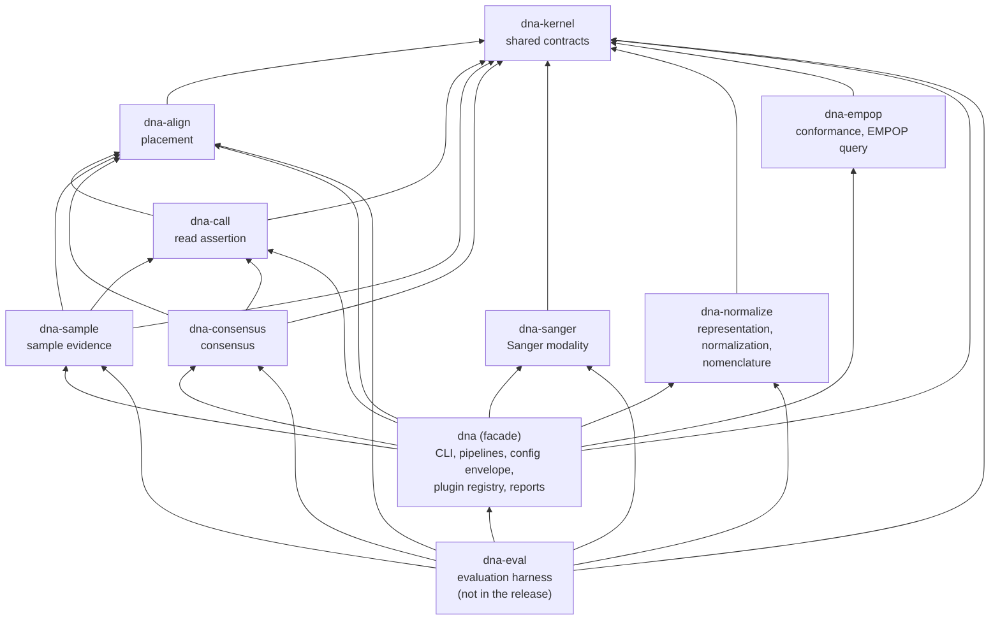

# Architecture Overview

## Principles

- Biological target, sequencing modality, external file format, and analysis
  capability are separate architectural dimensions.
- Canonicalize formats at adapters; canonicalize biological evidence only where
  semantics actually converge.
- DNA owns scientific semantics and canonical contracts; maintained ecosystem
  implementations provide commodity bioinformatics machinery when they satisfy
  those contracts.
- One strict configuration and one command-specific JSON result per CLI
  invocation; `consensus` also writes its FASTA.
- Untrusted binary/text input is checked before slicing, conversion, and large
  allocation.
- Models enforce cardinality and coordinate invariants; scientific stages avoid
  filesystem side effects.
- The CLI and operating-system boundary remain thin.
- Algorithms are deterministic and biologically explicit.
- Every source directory has a colocated README that routes implementation
  ownership.

## Module boundaries

| Module | Crate | Owns | Excludes |
|---|---|---|---|
| `cli` | dna | command syntax | I/O and algorithms |
| `config` | dna | strict loading of the configuration envelope that composes the plugin-owned sections; names the target profile | section rules (owned by each plugin), per-value environment overrides, target knowledge |
| `profile` | kernel | target profiles: reference identity/topology, regions, nomenclature windows, notation | running rules, loading references |
| `error` | kernel | typed cross-stage failures | logging and recovery policy |
| `operation_log` | dna | append-only operational records rendered from `tracing` events | scientific decisions |
| `checksum` | kernel | stable SHA-256 byte identity | file I/O and policy |
| `locus` | sanger | Sanger locus window geometry | signal interpretation |
| `model` | kernel, align, call, sample, consensus, sanger, dna | validated domain vocabulary; each child belongs to the crate of its family (Sanger evidence and attachments to `sanger`) | filesystem and algorithms |
| `variant` | kernel | public canonical called-variant contracts | evidence and call mappings |
| `plugin` | kernel | plugin descriptor types and their compile-time validation; each plugin declares its own descriptor, and `pipeline::plugins` lists the registry and workflow compositions | running stages, configuration values |
| `read_evidence` | kernel | modality → core per-read evidence contract: bases, profiles, labelled masks with their onset, support vetoes, informative interval | modality algorithms, interpreting reason labels |
| `input` | dna | loading orchestration (configuration, profile, reference) and source adapters: Sanger traces (`sanger`, decoding through `dna_sanger::abif`), reviewed consensus sequences with their `ReadEvidence` adapter, and variants documents | CLI publication paths and scientific algorithms |
| `reference` | kernel | validated reference identity/model | alignment |
| `abif` | sanger | bounds-checked ABIF decoding into a chromatogram | scientific interpretation |
| `bounds` | kernel | shared configuration range checks | section rules |
| `read_processing` | sanger | shared reference-free Sanger read processing; the Sanger adapter that builds `ReadEvidence` (support vetoes, mask reasons) | reference interpretation |
| `basecalling` | sanger | signal-derived calls | trimming/reference knowledge |
| `signal_processing` | sanger | observation-only Sanger signal evidence | reference interpretation |
| `callability` | sanger | signal-derived per-read phase state, typed mask, callable span; modality-generic core plus one Sanger adapter | channel/call mutation, basecall rescue, reference or profile knowledge, variant decisions |
| `quality_control` | sanger | relative quality; trim interval from the callable span | deciding callability, variant filtering |
| `run_signal` | sanger | the second-channel signal a run's reads share, recorded as `dna.signal/v1` (PROP-0009) | per-read decisions |
| `decompose` | sanger | the phase mixtures of a dephased stretch after a repeat run (SRS-CALL-023, ADR-0082); evidence only | deciding a call, reference knowledge |
| `second_cause` | sanger | labels why a call shows a second peak (SRS-CALL-021); labels only | any verdict, mask, call, or review item |
| `alignment` | align | current profile-aware pairwise placement/orientation of `ReadEvidence` | variant extraction, input-format parsing, modality types |
| `variant_calling` | call | evidence-backed differences, mapping, allele anchoring, the one trust rule (`Eligibility`), reporting modality vetoes and mask reasons | target nomenclature, genotype/clinical interpretation, modality types |
| `components` | call | compares each component of a read's phase mixtures with the reference on its own (SRS-VAR-022) | deciding a call, modality types |
| `variant_analysis` | dna | Sanger one-read composition (modality plus core) and the public Variant Analysis capability | CLI logging/JSON publication |
| `sample_analysis` | dna | the sample placement pass (each trace placed once, reads run concurrently), its aggregation and consensus, and the public Sample Analysis capability, whose consensus call (`SampleAnalysis::call`, implemented in `pipeline`) completes the `consensus` then `call` workflow in process | CLI logging/JSON publication, comparison with truth |
| `read_call` | call | the core's one-read path from `ReadEvidence` to a `CalledRead`, the sections a called read needs (`CallConfig`), and the `core` plugin descriptor | modality types |
| `sample` | sample | multi-read evidence aggregation over modality-neutral `CalledRead` records | input discovery/consensus, modality types |
| `consensus` | consensus | adjudication between a sample's placed reads into consensus segments with the evidence of each decision (ADR-0073) | variant calling of the consensus (done by `call`), modality types, heteroplasmy |
| `noise` | consensus | a batch's length noise for the two-strand rule, as additive statistics, and τ calibrated by it (`dna.run_context/v1`, PROP-0014) | reading files, deciding a length |
| `decided` | consensus | calls the consensus's decided edits without placing the consensus again (ADR-0078) | placement, modality types |
| `variant_representation` | post | haplotype-preserving edit conversion, application, rendering | policy choices |
| `variant_normalization` | post | optional sequence-equivalent normalization policies | nomenclature windows |
| `variant_nomenclature` | post | profile-driven window representation engine | target knowledge, notation rendering |
| `conformance` | post | reporting represented calls that break the profile's notation conventions | rewriting calls, target knowledge |
| `report` | dna | contract projection, serialization, atomic publish | scientific decisions |
| `pipeline` | dna | CLI orchestration of every command (analyze, basecall, sample, consensus, call, notation), path/log/publication lifecycle | scientific implementation ownership |

DNA is a Cargo workspace of plugin-family crates, with the core split by step
([[ADR-0070]],
[[ADR-0079]],
[crates](../../crates/README.md)):

- `dna-kernel` holds the shared contracts;
- the core caller is four crates, one per step, in a chain: `dna-align`
  (placement), `dna-call` (the read assertion), and on both `dna-sample`
  (sample evidence) and `dna-consensus` (the consensus);
- `dna-sanger` is the Sanger modality;
- `dna-normalize` holds post-calling representation, normalization, and
  nomenclature, and `dna-empop` holds conformance
  ([[ADR-0077]]). The core
  decides the sequence; normalization only writes it, and conformance only
  checks it (ADR-0077 §5);
- the `dna` facade at the repository root composes them;
- `dna-eval` is the evaluation harness: it runs DNA over a test panel through
  the facade's library and compares the calls with reviewer truth
  ([[ADR-0075]]). It also renders the simulated tract-decode bench through
  `dna-trace`'s `simulate` feature ([[validation/simulated-bench]]). It is
  not part of the `dna` binary or the release. The harness is the library
  `dna-eval-lib` under a thin `dna-eval` binary that records what it was
  built from, so a new commit relinks the binary without recompiling the
  harness.

An arrow reads "depends on" and shows each direct dependency of the manifests.
The core steps form a chain (align, then call, then sample and consensus), no
plugin crate depends on another, and nothing depends on the harness.
`validate_module_layers.py` enforces the graph from sources and manifests.

The Crate column above uses the short names. Each core crate depends only on
`dna-kernel` and the steps before it; the other plugin crates depend only on
`dna-kernel`, and only `dna` composes them. The harness may depend on `dna` and
the plugin crates; no crate depends on the harness, and truth formats and
comparison live nowhere else (SRS-COMPAT-003). Each plugin owns its
configuration sections and its descriptor. CI enforces the crate graph and an
acyclic module graph within each crate with `validate_module_layers.py`, and
tests each plugin crate on its own.

Dependencies point toward shared model/config/error and capability boundaries;
cycles are forbidden.

External libraries may implement commodity algorithms or formats behind these
boundaries, but dependency-specific types must not become accidental DNA domain
contracts. See [[engineering/dependencies|dependency policy]] and
[[ADR-0059]].

## Resource bounds

Config/profile/FASTA source files, ABIF input, normalized reference length, changed indel
length, and alignment cells are explicitly bounded. Exact current limits and
requirements are owned by [requirements](../requirements/README.md) and
[[reference/configuration|configuration reference]].
