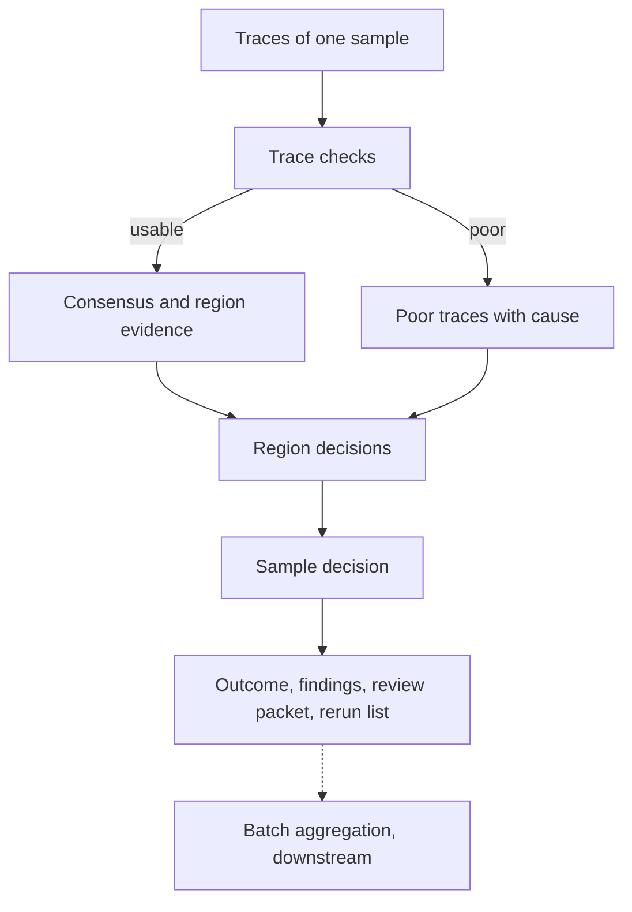
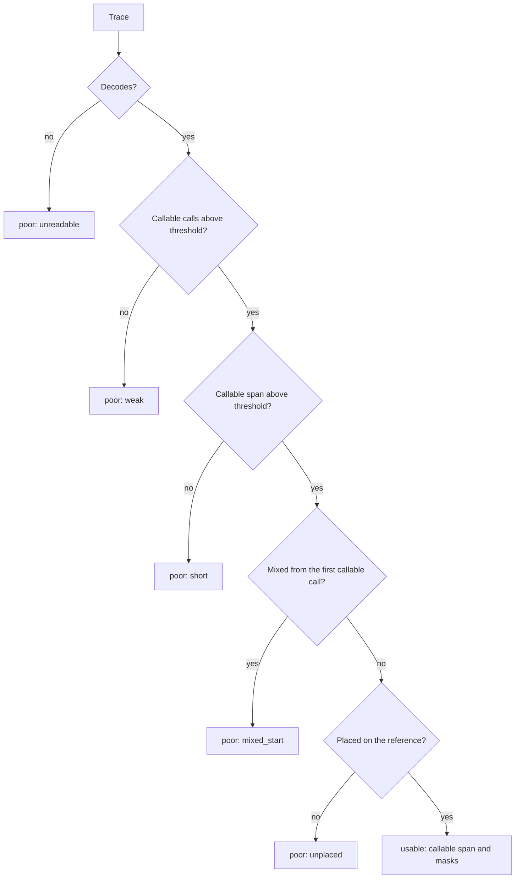
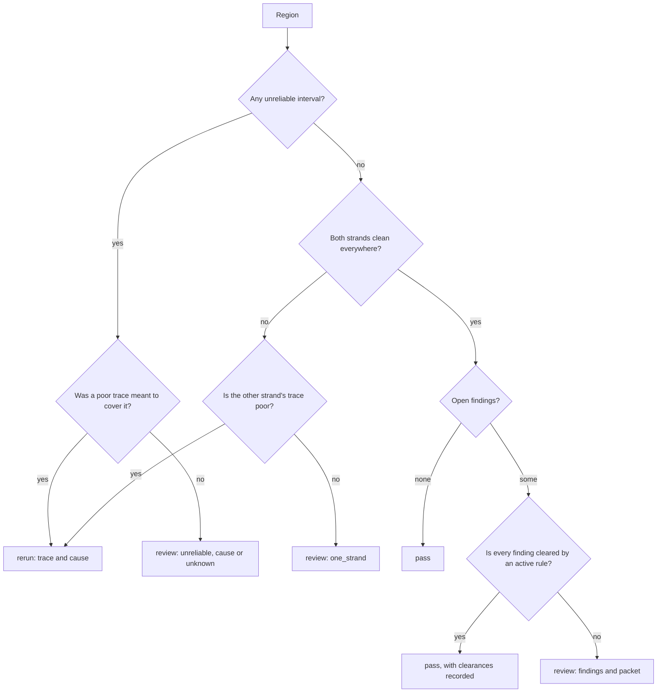
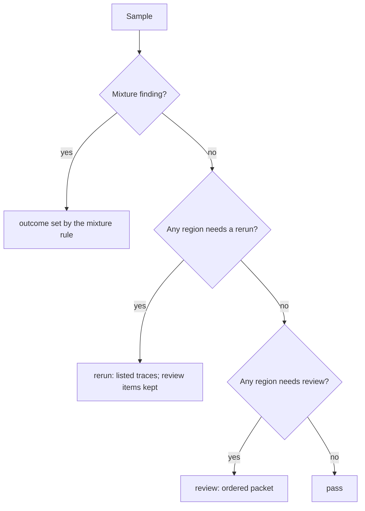
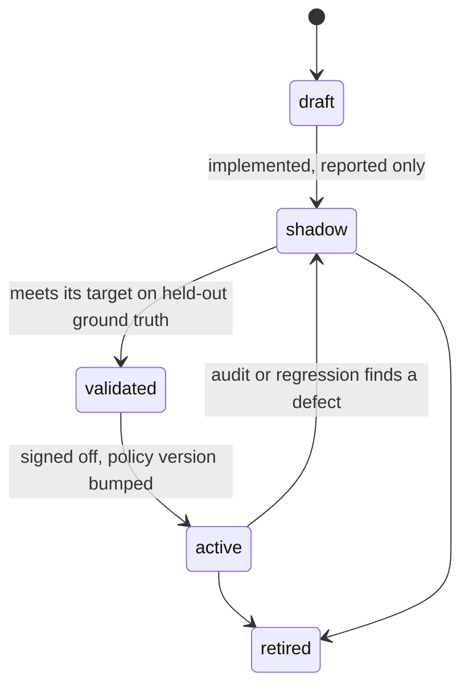

# Proposal: Review triage

## Problem

DNA's [purpose](../requirements/SRS.md#purpose) is to sort sequencing work
into pass, review, and rerun. Today DNA reports the evidence for each
decision but never the decision:

- **trace evidence** — callability, the callable span, rejected reads with a
  typed cause;
- **region evidence** — masked calls, eligibility reasons, opposition, and the
  consensus marks `N`, `contested`, `phase_loss`, `reference_frame`;
- **sample evidence** — coverage, overlaps, and the consensus variants.

So a reviewer still opens every sample. Nothing says which samples need no
look, which regions need one and why, and which traces should go back to the
lab.

This proposal designs the *system*: concepts, decision flow, rule approval,
determinism, and what each outcome must deliver. Biological rules such as
heteroplasmy and run lengths come later, as rules inside this system.

## Goals

Each outcome carries its own obligation:

- **Pass.** DNA resolves the result by itself. Every pass rests on evidence,
  and the rule behind it must be tested against ground truth and approved
  above a set threshold before it may act.
- **Review.** DNA cannot resolve the result, but a reviewer can settle it from
  the traces. DNA gives the reviewer the information and insight to decide:
  - what is uncertain;
  - the candidate answers;
  - the evidence for each candidate;
  - why no rule cleared it.

  A bare list of regions is not enough.
- **Rerun.** A trace is too poor or unreliable to settle anything. DNA
  detects the problem from evidence, against thresholds, and
  deterministically: the same trace always gets the same verdict and cause.

Across all three:

- measure A % (pass), B % (review), C % (rerun), and the error rate of passed
  results against ground truth;
- use these numbers to rank further work.

The evaluation method and the fast feedback loop are in
[PROP-0005](0005-evaluation-feedback-loop.md).

## Non-goals

- Biological interpretation rules. They plug into this system later as
  individual rules.
- Setting the lab's rerun rate. The chemistry sets it; DNA only detects it.
- Comparing results with reviewers or other tools inside the triage rules.
  Comparison belongs to the evaluation harness
  ([PROP-0005](0005-evaluation-feedback-loop.md)).
- Batch decisions. Batch is the top level and comes last, and downstream
  pipelines aggregate it.
- Sample swaps. The data cannot show a swap.
- Checking that a sample has all its expected traces. Samples normally do.

## Evidence and research

- **[Review-triage research](../research/review-triage/README.md).** Clinical
  autoverification, selective classification, vendor trace metrics, and lab
  rerun practice.
- **DNA measurements on held-out reviewer truth.**
  - Unmasked calls are about 99.98 % right; errors cluster where reads
    dephase and where only one read is callable. Those places can already be
    told apart, so a cautious system can route them to review.
  - The consensus matches reviewers exactly on 297 of 320 evaluation samples.
    A passed sample must be exact, so A is at most that share until the
    consensus improves.

## Proposed design

### Concepts

| Concept | Meaning |
|---|---|
| **error** | A difference between DNA's final result and the ground truth at one site or interval. Only an evaluation can see it, because it needs the truth. |
| **unreliable region** | An interval where DNA's own evidence does not support a confident answer. DNA detects it without the truth. |
| **finding** | A typed record that a rule raised: level, location, cause (possibly `unknown`), and the evidence values against their thresholds. |
| **rule** | A named, versioned, deterministic function from evidence to findings (a *detector*), or from a finding and its evidence to a clearance (a *resolver*). |
| **policy** | The active rules, their parameters, and their outcome mapping, with one version. |
| **outcome** | `pass`, `review`, or `rerun` for a region, trace, or sample, with its findings and the policy version. |

**Pass is an allow-list.** A region passes only when positive evidence is
present (every position read cleanly from both strands) and every finding is
cleared by an active resolver. A finding that no resolver clears goes to
review, so a new or unknown problem can never pass silently.

### Error model: detect first, diagnose later

DNA does not need to know what went wrong before it knows *where* it cannot
be trusted. The model has two stages.

1. **Detection.** Detectors mark unreliable regions and poor traces. Every
   such region carries the cause `unknown` unless a detector knows better. A
   region that no detector marks is reliable.
2. **Diagnosis.** Once an unreliable region is caught, more specific
   detectors give it a cause (dephasing, a single strand, conflicting reads,
   and so on). A cause makes the review packet richer and may let a resolver
   clear the region. It never makes an unmarked region unreliable after the
   fact.

Stage 1 alone already reaches the purpose:

- reliable regions pass;
- unreliable regions go to review;
- poor traces that a region needs go to rerun.

Stage 2 lowers B over time.

The evaluation scores the stages separately ([PROP-0005](0005-evaluation-feedback-loop.md)):

- **Detection quality.** Every error must lie inside an unreliable region.
  An error outside is a *leak*. Unreliable regions without an error are review
  burden.
- **Diagnosis quality.** The cause assigned to a caught error matches the
  cause found by inspection.

**Error classes.** An error is classified on three independent axes, not one
flat list.

| Axis | Values | Who sets it |
|---|---|---|
| level | trace, region, sample (batch downstream) | the detector |
| origin | `signal` (chemistry, input), `method` (a DNA limit or bug), `biology` (a real state such as heteroplasmy), `truth` (reviewer convention or reviewer error), `unknown` | diagnosis; `unknown` until known |
| action | `resolvable` (a resolver can clear it), `reviewable` (a reviewer can settle it), `rerun` (no one can settle it from this trace) | the policy, per cause |

Notes on the axes:

- **Origin `method`** errors are DNA's own work list. They are fixed in DNA,
  not in triage.
- **Origin `truth`** errors are not counted against DNA after adjudication.
- **A representation-only difference** (the same haplotype written another
  way) is not an error. The evaluation normalises notation first.

### Rule model

A rule is Rust code with a declarative description. A text rule language
would add an interpreter and still need Rust for the evidence types, so there
is none.

| Part | Content |
|---|---|
| identity | stable `id` (`region.one_strand`), integer `version`, owning crate (Sanger plugin for chemistry, core otherwise) |
| kind | `detector` (evidence → findings) or `resolver` (finding + evidence → clearance) |
| level | trace, region, or sample |
| inputs | the evidence fields it reads; only typed evidence, never file paths or truth |
| parameters | named thresholds with type, unit, allowed range, and comparison (`>=` or `>`), loaded from strict configuration |
| output | findings with cause, location, and for every parameter the measured value, threshold, and margin |
| status | `draft`, `shadow`, `validated`, `active`, or `retired`, set by the policy, not by the code |
| tests | synthetic-evidence unit tests at, just above, and just below each threshold |

Contract for every rule:

- **Pure and deterministic.** No I/O, clock, randomness, or global state. The
  result does not depend on trace order.
- **Bounded.** Work grows linearly with the evidence it reads.
- **Cheap.** Rules run on evidence that is already computed, never on raw
  signal again. Rule iteration then needs no re-alignment
  ([PROP-0005](0005-evaluation-feedback-loop.md)).
- **Bumped on change.** A changed rule gets a new version, and a changed
  parameter value gets a new policy version. Each outcome records both.

The registry lists every rule once, like the plugin registry (ADR-0069), and
is checked at compile time: ids are unique, and a parameter belongs to exactly
one rule. The policy file only switches status and sets parameter values.

### Finding catalogue

The catalogue is the first deliverable. Names are illustrative. Each
detector starts with cause `unknown` or a cause it can see directly.

| Stage | Level | Finding | Detected from (today) | Default outcome |
|---|---|---|---|---|
| 1 | trace | `trace.unreadable` | ABIF decode failure | poor |
| 1 | trace | `trace.weak` | too few callable calls (SRS-CALL-009) | poor |
| 1 | trace | `trace.short` | callable span below threshold | poor |
| 1 | trace | `trace.unplaced` | placement rejection (SRS-SAMPLE-029) | poor |
| 1 | region | `region.unreliable` | masked call, consensus `N`, `contested`, `phase_loss`, or `reference_frame`, with cause `unknown` | review |
| 1 | region | `region.one_strand` | position read cleanly by one strand only | review, or rerun if the other strand's trace is poor |
| 2 | trace | `trace.mixed_start` | mixed segment from the first callable call | poor |
| 2 | region | `region.conflict` | a call opposed by a clean observation | review |
| 2 | region | `region.unread_run` | a run whose length no read shows | review |
| 2 | region | `region.minor_signal` | second allele signal above threshold | review |
| 2 | region | `region.convention` | conformance finding | review |
| 2 | sample | `sample.mixture` | traces of the sample disagree beyond a threshold | set by policy |

A *poor* trace is a diagnostic, not yet a rerun. A rerun is required only when
a region cannot pass or be reviewed without a better trace.

### Decision flow

The work goes from the lowest level up: region, then trace, then sample. The
batch level is aggregated downstream.



**Trace checks** run on one trace alone, so they can run as soon as the trace
exists:



**Region decision:**



**Sample decision.** The worst outcome wins, in the order
rerun > review > pass. Every finding is kept, so review items survive a rerun
request.



### Rule lifecycle and approval

Only an `active` rule changes an outcome. Every other state is reported but
does not act. DNA already worked this way when callability was observation
only first and acted only after measurement (ADR-0067).



Approval targets differ by outcome:

| Rule kind | Approval target on held-out ground truth | Also reported |
|---|---|---|
| pass (clears a finding) | zero known errors, and an upper bound on the error rate at or below the policy target | gain in A |
| rerun (marks a trace poor) | precision at or above the target: a flagged trace truly could not settle its region | recall; C |
| review (raises a finding) | none needed, because review is the safe default | share of items where DNA's leading candidate matched the reviewer |

Datasets, splits, and the metrics behind these targets are defined in
[PROP-0005](0005-evaluation-feedback-loop.md). After go-live, a share of
passed results is sampled for audit review, so drift shows up as defects.

Each approval is a record of:

- the rule and its version;
- the dataset identity;
- the metrics;
- the approver and the date.

The record belongs with the release evidence (ADR-0018).

### Determinism

- **Reproducible.** The same traces, configuration, policy version, and DNA
  version give a byte-identical outcome.
- **Order-free.** The outcome does not depend on the order or file names of
  the traces. Property tests check this.
- **Exact thresholds.** Thresholds are fixed values with a documented
  comparison (`>=` or `>`) and rounding. A finding records the measured
  value, the threshold, and the margin between them, so near misses are
  visible.
- **Canonical order.** Findings and reasons are listed in a canonical order.

### Review list (canonical output)

Decided 2026-10-17. DNA replaces Tracy as the variant caller of the
laboratory's pipeline (`mtdna_raw`), and Review uses DNA's evidence to guide
the reviewer. DNA does **not** write the reviewer's conclusion: no issue text,
no requirement, no re-extraction primers. It lists the positions a reviewer
should look at, with the evidence-based labels that make each one quick to
settle. The laboratory integrates the output on its side from DNA's build;
DNA only defines the output.

**Document.** One document per sample, `dna.review/v1`, written by
`dna review <sample-id> <trace>... --reference <fasta>` as
`results/<sample-id>.review.json`. The command runs the in-process path of
SRS-API-012 (sample analysis, consensus, `call`, notation), so the
laboratory's tool calls DNA once per sample. Every sample gets a document:
when every read is rejected, or the call fails, the document carries that
status and the rejected reads with their causes instead of an error. Its
schema reuses the `notation/v1` definitions (calls with convention labels,
callable ranges, the EMPOP query) by reference rather than copying them.
It carries:

- provenance (reference, configuration, profile, plugins with versions, and
  the version of the labelling rules, since `clear` depends on them);
- the reads: file name, content SHA-256, strand, admitted or rejected with
  the cause;
- the sample's calls in the profile notation, with their convention labels
  (as in `notation/v1`);
- the callable ranges and the EMPOP query (as in `notation/v1`);
- the **items**, ordered by priority;
- a summary: counts per label, and `clear` when no item is a `check`.

**Item.** One consensus site or stretch, or one position outside any site,
given by its first and last rCRS columns (`position` and an insertion
`ordinal`, so `309.1` is `309`/`1`). A run window is settled once: `309.1C
309.2C 315.1C` in one stretch is one item, with the stretch's run structure
attached, not three.

- `kind`: `variant` (DNA calls a difference from the reference) or `check`
  (DNA could not assure the position);
- what DNA decided there: its call, `not_callable`, or the reference;
- `labels`: evidence for the reviewer, each computed from DNA's own evidence
  and never from a truth:

| Label | Means | Evidence it carries |
|---|---|---|
| `strands_disagree` | clean reads of both strands disagree on the item's decided sequence: a supporting read on one strand and an opposing read on the other, as the consensus counts them (a conflict) | each read's sequence |
| `one_read` | a single read shows the call | the read |
| `one_strand` | only one strand reads the position cleanly | the strand and reads |
| `possible_heteroplasmy` | a second base is shown by the reads beyond their shadow | the base, its share per read, the strands showing it |
| `phase_shift` | a covering read loses phase at or before the position | the read and where its shift starts |
| `noisy_signal` | a covering read is masked here | the read and the modality's reason, verbatim |
| `read_edge` | the position is inside a read's edge margin | the read |
| `estimated_length` | a run's length is an estimate, so its 3' end is not callable | the run, its evidence (`phase_loss`, `reference_frame`) |
| `undecided` | no clean observation, or a tie | the reads that cover it |
| `not_covered` | no admitted read covers it inside the profile's regions | — |

- `evidence`: the reads behind the labels: name, strand, the sequence each
  read shows over the item, its call indices and, from the modality, the
  trace scan position of each call (so Review can jump to the peak), the
  per-call relative quality, and the second-base share where one applies.

**Priority.** Within each priority, items follow rCRS order (position, then
ordinal), so the document is deterministic. `strands_disagree`, then `possible_heteroplasmy`, then
`estimated_length` and `undecided`, then `one_read` and `one_strand`, then
the remaining labels; variants without a label last. Only positions DNA
cannot assure are `check`; a variant every read shows cleanly on both
strands is listed as a `variant` with no label, for completeness.

**Watched positions.** A target profile may declare positions the
laboratory wants to see in every sample, each with a reason:

```toml
[[review.watch]]
positions = [73]
reason = "read start of the forward HV2 read"
```

Each watched position is always an item, labelled `watched` with the
profile's reason, and carries the raw signal of every read that covers it,
including calls the modality trimmed or masked: the base, the peak heights,
the number of qualifying channels, and the trace scan position. A watched
position changes nothing else: not the calls, the consensus, the callable
ranges, or any trust. The list is the profile's data, so another profile (for
example one for a given population) declares its own; the core has no
position in its code. The raw signal at a position is the modality's to give.
Its agreement with the truth at each watched position is measured like any
label.

**Availability.** Most labels come from what the analysis holds today:
`strands_disagree`, `one_read`, `one_strand`, `read_edge`,
`estimated_length`, `undecided`, and `not_covered`; `phase_shift` and
`noisy_signal` are provisional until the modality's verdicts carry their
reasons (PROP-0008 step 4). `possible_heteroplasmy` needs a per-call verdict
from the modality (the second base and its share), because the core must not
read Sanger peaks; that verdict is the first piece of PROP-0008 step 4. The
counts of the strand labels move when step 4 unifies trust; their shape does
not.

**Two strands.** A position read cleanly by both strands must agree, or it
is a `strands_disagree` check. A position only one strand covers is called
when its reads are clean and labelled `one_strand`; it is not a check by
itself.

**Over time.** DNA's labels replace Review's own check flags, or Review lets
the reviewer choose the engine. Each reviewer action on an item (accepted,
changed) is information the laboratory can return to measure each label's
precision in production, where no truth exists.

### Rerun request

A rerun names:

- the trace;
- the cause (a finding code that the lab can map to an action such as
  re-inject, clean up again, or PCR again);
- the evidence values and thresholds;
- the regions that need the trace.

### Ownership and contract

- **Modality:** trace findings that depend on the chemistry, and the trust
  verdicts the labels read (PROP-0008).
- **Core and sample evidence:** the items and labels over the consensus and
  the reads, with no modality types (PROP-0008, `dna-sample`).
- **Policy:** configuration or the target profile, versioned and recorded in
  every outcome.
- **Contract:** `dna.review/v1`, the canonical per-sample output for the
  laboratory's tool, assembled by the facade. A new contract: an SRS-API
  requirement, a reference page, a schema and an example, and a CHANGELOG
  entry come with it.

### Decisions so far

Agreed in review on 2026-10-14:

- the error catalogue comes first;
- the levels are region, trace, sample, and batch, worked from the bottom up;
- a pass normally needs both strands, with exceptions to be discussed;
- sample swaps and missing traces are out of scope;
- mixtures are detectable when the traces of a sample differ too much;
- when the error is not yet known, detect the unreliable region first and
  diagnose the error later;
- rules are measured against about 100,000 samples with reviewer results,
  with a fast feedback loop (PROP-0005).

Decided 2026-10-17 (user):

- DNA replaces Tracy in the laboratory's pipeline and gives Review its
  evidence; the laboratory integrates `dna.review/v1` itself from DNA's build;
- DNA lists positions and labels, never the reviewer's conclusion;
- one strand is a label, not a review trigger; two strands that disagree are
  a conflict;
- over time DNA's labels replace Review's check flags, or Review offers an
  engine choice;
- rules and labels must generalize: no position-specific rules, and every
  threshold is checked on samples it was not tuned on.
- a profile may declare watched positions; they only add review items with
  their raw signal and never change a call.

## Alternatives considered

- **Leave triage to downstream pipelines.** Rejected as the main path. A pass
  needs DNA's evidence types (masks, run structure, profiles), and downstream
  rules would copy them. Downstream still owns batch, controls, and
  comparison.
- **One score with a threshold.** Rejected. A score hides the reason, cannot
  name a rerun cause, cannot be approved rule by rule, and DNA's quality is
  not calibrated (SRS-QC-002).
- **Pass as "no finding raised" (deny-list).** Rejected. An unknown problem
  would pass. Pass needs positive evidence plus clearance (allow-list).
- **Sample-level outcomes only.** Rejected. Reviewers act on regions and the
  lab acts on traces.

## Validation plan

Review list (on development panel v5, then on a readiness panel of later
batches):

- **recall**: every position where DNA's sample result differs from the truth
  (haplotype measures, inside the truth's analysed intervals) is an item,
  except where DNA's call is clean on both strands;
- **burden**: items and `check` items per sample (median, 90th percentile),
  and the share of `clear` samples;
- **label precision**: for each label, the share of its items where the truth
  differs from DNA's call or holds a code (for `possible_heteroplasmy`);
- **leaks among `clear` samples**: the approval measure of PROP-0005, before
  any auto-pass is allowed.

- **Phase 0, before any production code.** Stage 1 detectors from today's
  evidence, measured with the method of
  [PROP-0005](0005-evaluation-feedback-loop.md). The leak and A/B/C numbers
  decide whether the system is worth building. Results below.
- **Per rule.** The approval targets above, on held-out ground truth.
- **System.** Property tests for determinism and order independence, and a
  regression check that the outcomes of the approval set do not change
  without a policy version bump.
- **After go-live.** An audit sample of passed results.

### Phase 0 results

Measured on 2026-10-15 with the draft triage of the evaluation harness
(`dna-eval run --triage`,
[draft triage](../validation/evaluation-harness.md#draft-triage)) on the
development panel v3: 2,618 active samples, revision 6a84daa plus the draft.
The detectors are drafts in the harness, not DNA rules. The lab's database
refresh of 2026-10-15 09:53 removed the truth of one zero-weight panel sample,
so the run reports the truth as changed; that sample now counts in A/B/C but
not in leaks or catches, and no other number moved.

**Draft policy.** `trace.short` below 100 calls; `region.unreliable` for `N`,
`contested`, `masked` sites, `phase_loss`, and `reference_frame`;
`region.one_strand`; `region.gap`; a poor trace is asked for by a rerun when
its primer (from the trace name) reads the region on a missing strand. The
draft has since gained `region.minor_signal`
([minor-signal results](#minor-signal-results)); the numbers in this section
are those of the stage-1 policy without it (the sweep's `minor_off`).

**A/B/C.**

| Level | Pass | Review | Rerun |
|---|---:|---:|---:|
| samples | 515 (19.7 %) | 2,025 (77.4 %) | 78 (3.0 %) |
| samples, corpus-weighted | 0.178 ± 0.023 | 0.799 ± 0.023 | 0.023 ± 0.006 |
| regions (HVS-I, HVS-II, HVS-III) | 42.9 % (40.0, 36.6, 52.0) | 55.4 % | 1.7 % |
| regions, corpus-weighted | 0.424 (0.408, 0.340, 0.524) | 0.563 | 0.013 |

No sample failed, and every sample had an admitted read. The clean stratum passes 36 %; the poly-C strata pass
almost nothing (`16189C` 3 %, `309.2C` 1 %), and samples with missing traces
none.

**Leaks** (passed samples that are not concordant; one-sided 95 %
Clopper–Pearson upper bound):

| Measure | Leaks / passed | Rate | Upper bound | Corpus-weighted |
|---|---:|---:|---:|---:|
| primary | 50 / 515 | 0.097 | 0.121 | 0.055 |
| strict | 50 / 515 | 0.097 | 0.121 | 0.055 |
| IUPAC-compatible | 9 / 515 | 0.017 | 0.030 | 0.002 |
| haplotype | 44 / 515 | 0.085 | 0.109 | 0.054 |
| haplotype IUPAC-compatible | 1 / 515 | 0.002 | 0.009 | 0.0001 |

The haplotype measures (added after this measurement, same samples and
policy) do not count a haplotype written or placed differently
([measures](../validation/evaluation-harness.md#measures)).

What leaks is invisible to stage-1 evidence:

- **Heteroplasmy.** 41 of the 50 primary leaks differ only at truth IUPAC
  alleles that both strands read cleanly, where the consensus calls one base.
- **Representation.** The other 9 differ only in how a clean haplotype is
  written or placed: HVS-I poly-C length variants at other positions
  (5 samples), an HVS-II poly-C insertion (1), `248DEL` against `249DEL` with an
  AC-repeat deletion (1), and one sample whose truth positions in HVS-I are
  shifted by one against DNA's (to adjudicate). The haplotype
  IUPAC-compatible measure confirms the first 8 as the same sequence; the
  shifted sample is its one leak (six substitution pairs one base apart, a
  truth-origin candidate).
- **Region leaks** follow the same pattern: of the 301 primary discordant
  positions inside passed regions, most lie in the HVS-I poly-C window
  (16180–16195), insertions and substitutions written at other positions.

**Detectors** (over 657 primary not-concordant samples; unique = flagged by
no other applied detector; sole burden = concordant samples that pass once
the detector is cleared):

| Detector | Samples | Catches | Unique | Burden | Sole burden |
|---|---:|---:|---:|---:|---:|
| `region.one_strand` | 1,920 | 553 | 8 | 1,367 | 118 |
| `region.unreliable:masked` | 1,753 | 550 | 8 | 1,203 | 56 |
| `region.gap` | 1,236 | 480 | 0 | 756 | 9 |
| `region.unreliable:n` | 1,157 | 469 | 0 | 688 | 0 |
| `region.unreliable:reference_frame` | 481 | 124 | 0 | 357 | 0 |
| `region.unreliable:phase_loss` | 142 | 40 | 0 | 102 | 0 |
| `region.unreliable:contested` | 53 | 20 | 6 | 33 | 3 |

`masked_read` (a covering read masked at the position) is measured but not
applied: it flags 2,097 samples, and applying it would add 9 primary catches
for 68 concordant samples no longer passing.

- **One strand** covers whole halves of a region in samples with poly-C
  length heteroplasmy (`16189C`, `309.1C`/`309.2C`): each read dephases at the
  poly-C, so the far side is read by the opposite primer only. Region starts
  at the primer ends (16024–16031, 73–80) give gaps and one-strand
  positions.
- **Nested causes.** Every sample that `N`, `phase_loss`, or
  `reference_frame` flags is flagged by another detector too (an `N` position
  is a gap), so they add no catch; they are diagnosis causes rather than
  stage-1 detectors.
- **Poor traces.** 92 poor traces, 87 asked for by a rerun. Most traces with
  a callable span under 200 calls are HV1F traces whose span ends near the
  HVS-I poly-C (150–250 calls), so `trace.short` at 200 calls sends 27 % of
  samples to rerun for a length heteroplasmy a rerun cannot fix; at 100 calls
  2.3 %.

**Sweep** (risk–coverage; corpus-weighted A, leaks over passed samples):

| Policy | A | Primary leaks (bound) | IUPAC-compatible leaks (bound) | Haplotype IUPAC-compatible leaks (bound) |
|---|---:|---:|---:|---:|
| draft | 0.178 | 50 / 515 (0.121) | 9 / 515 (0.030) | 1 / 515 (0.009) |
| `region.one_strand` off | 0.237 | 58 / 641 (0.111) | 10 / 641 (0.026) | 1 / 641 (0.007) |
| `masked` off | 0.220 | 58 / 579 (0.123) | 13 / 579 (0.036) | 1 / 579 (0.008) |
| one-strand and `masked` off | 0.418 | 119 / 1,046 (0.131) | 35 / 1,046 (0.044) | 6 / 1,046 (0.011) |
| gap only | 0.504 | 177 / 1,381 (0.144) | 70 / 1,381 (0.062) | 38 / 1,381 (0.036) |

`trace.short` and the proxy move samples only between review and rerun
(C 0.008 with the detector off, 0.023 at 100, 0.270 at 200 calls; the `any`
proxy adds 0.0002).

**Speed.** The panel run with the draft triage takes 7–11 s on 32–64
threads; deciding and scoring all 14 policies takes about 1 s. Outputs are
byte-identical between thread counts, and the run without `--triage` is
unchanged.

**Conclusion.** Stage 1 is worth building as the detection layer, but not on
its own as the pass rule:

- **Its leaks are not stage-1 errors.** Every leak is heteroplasmy or a
  difference in how or where a clean haplotype is written, neither of which
  stage-1 evidence can show. A
  pass rule therefore needs, before approval, a minor-signal detector
  (`region.minor_signal`) as a pass gate
  ([minor-signal results](#minor-signal-results)), and is judged on the haplotype
  measures, which no longer count representation: under the haplotype
  IUPAC-compatible measure the draft leaks 1 of 515 passed samples (upper
  bound 0.009).
- **Its A is too low.** About 18 % corpus-weighted. The largest lever is a
  one-strand resolver for poly-C dephasing (open question 6), then region
  edges at the primer ends.
- **Detectors first:** `region.gap`, `region.unreliable` for `N` and
  `contested` (the best catches per burden), `region.one_strand`, and the
  trace rejections. `masked` sites second, with their burden measured.
  `phase_loss` and `reference_frame` serve diagnosis. `trace.short` at
  100 calls or off, with the primer proxy for reruns.

### Minor-signal results

Measured on 2026-10-15 with the same panel, truth, and harness at revision
a244644 plus the minor-signal draft (`region.minor_signal`,
[minor rules](../validation/evaluation-harness.md#draft-triage)), on the
development panel only.

**Evidence.** The sample evidence keeps A/C/G/T profiles only at
differential loci, where some read differs from the reference. Two thirds of
the truth IUPAC positions that leaked in phase 0 are positions where DNA calls
the reference base, so they are differential only when a read happens to call
the minor base. The harness therefore reads every covered position through a
new read-only accessor, `SampleAnalysis::observations` (SRS-API-013), and
keeps per
read its minor channel (the strongest channel other than its call), whether
that base is a neighbour's (a shadow), and its local noise.

**What separates a second allele from noise.** Of the 90 truth IUPAC
positions inside regions that pass without the rule (the 41 heteroplasmy
leaks), 18 show no minor channel of 0.05 or more in any read (mostly the
HVS-I poly-C, 16189–16193, where DNA's call is shifted or another length).
At homoplasmic positions of concordant samples, a pair seen on both strands
at 0.10 or more is almost always a shadow: 736 positions in 258 samples, of
which 3 remain when neither neighbour's base may count (but only 30 of the 90
true sites do) and 101 in 53 samples when only the base of the next
reference position may not (41 true sites). That base is a shadow on both
strands (the next call of a forward read, the previous call of a reverse
read). The previous reference base is the minor base of about one in seven
shadow reads, but of one in four reads at true sites, where it is the second
allele itself (HVS-II C/T sites such as 146, 152, and 195). A local
noise ratio, a read's local shadow level, or agreement of the two strands'
minor weights did not separate them better (the last two measured
exploratorily on the same evidence, not kept).

**Rules** (against the stage-1 draft with the rule cleared: corpus-weighted
A 0.178, primary leaks 50 / 515; moved = compared samples the rule alone
sends to review, burden = the concordant ones among them):

| Rule | A cost | Moved | Burden | Primary leaks (bound) | IUPAC sites caught |
|---|---:|---:|---:|---:|---:|
| `strands@150` | 0.025 | 101 | 82 | 31 / 414 (0.100) | 26 / 90 |
| `strands@100` | 0.059 | 217 | 182 | 15 / 298 (0.077) | 47 / 90 |
| `unshadowed@150` | 0.001 | 11 | 0 | 39 / 504 (0.100) | 20 / 90 |
| `unshadowed@100` | 0.005 | 16 | 2 | 36 / 499 (0.094) | 30 / 90 |
| `unshadowed@80` | 0.009 | 25 | 9 | 34 / 490 (0.091) | 33 / 90 |
| `upstream@120` | 0.011 | 37 | 21 | 34 / 478 (0.094) | 31 / 90 |
| **`upstream@100`** | **0.020** | **57** | **35** | **28 / 458 (0.083)** | **41 / 90** |
| `upstream@80` | 0.031 | 89 | 62 | 23 / 426 (0.076) | 46 / 90 |
| `noise@150` | 0.022 | 92 | 73 | 31 / 423 (0.098) | 26 / 90 |
| `any@200` | 0.021 | 48 | 33 | 35 / 467 (0.098) | 19 / 90 |
| `lone@100`, one-strand off | 0.012 | 41 | 24 | 41 / 600 (0.088) | 33 / 110 |

`triage_minor.tsv` holds every rule at 60–250 thousandths.

**Default: `upstream@100`,** the cheapest swept rule that removes more than
half of the heteroplasmy leaks. `unshadowed@100` is the precise alternative:
a third of them for a quarter of the cost.

| Level | Pass | Review | Rerun |
|---|---:|---:|---:|
| samples | 458 (17.5 %) | 2,082 (79.5 %) | 78 (3.0 %) |
| samples, corpus-weighted | 0.158 ± 0.022 | 0.819 ± 0.022 | 0.023 ± 0.006 |
| regions | 41.5 % | 56.8 % | 1.7 % |
| regions, corpus-weighted | 0.410 | 0.576 | 0.013 |

| Measure | Leaks / passed | Rate | Upper bound | Corpus-weighted |
|---|---:|---:|---:|---:|
| primary | 28 / 458 | 0.061 | 0.083 | 0.035 |
| strict | 28 / 458 | 0.061 | 0.083 | 0.035 |
| IUPAC-compatible | 8 / 458 | 0.017 | 0.031 | 0.002 |

- **Leaks.** Heteroplasmy leaks fall from 41 to 20 samples; 8 leaks are
  representation differences (6 in a repeat window, 2 other). The rule marks
  41 of the 90 IUPAC positions in regions that pass without it, and 96 of the
  343 inside any region.
- **Blind spot.** The residual heteroplasmy leaks sit at 21 truth IUPAC
  positions. Their alternate base equals the next reference base only (3),
  both neighbours (4), the previous reference base only (3), or neither (11).
  `upstream` cannot mark the first two classes by construction (7 of 21);
  the others fall below the threshold, show no minor channel, or are read
  cleanly by one strand only. Corpus-wide the blind classes are about 21.7 %
  of heteroplasmy sites ([harness](../validation/evaluation-harness.md)), so
  the upper bound above holds only for the classes the rule can see. A
  symmetric shadow test is the next iteration.
- **Burden.** `region.minor_signal` flags 403 samples (178 primary catches,
  22 that no other applied detector makes; 225 concordant, 35 held back by it
  alone) and marks 100 primary discordant positions itself.
- **Speed.** The run with the 56 policies takes about 15 s on 64 threads, of
  which deciding and scoring take about 9–10 s; taking the minor channels
  costs less than 1 % of DNA's time on one thread. Outputs are
  byte-identical between 1 and 64 threads.

**Conclusion.** A cross-strand minor-signal detector that drops only the
shadow both strands share halves the heteroplasmy leaks at a review cost of
about two percentage points of A. The rest is out of its reach as built: a
third of the remaining sites show no minor channel, and the others need a
shadow model of the read (the previous reference base) rather than a
neighbour test. Recall rather than precision limits it, so the next steps
are a shadow-corrected minor channel in the Sanger plugin (the
[point-heteroplasmy](../research/point-heteroplasmy/README.md) prerequisite)
and the HVS-I poly-C sites, before the rule is measured on held-out truth.

### Local shadow

`upstream` cannot see an allele that equals the next reference base, or
both neighbours, by construction: about 21.7 % of the corpus's heteroplasmy
sites. A neighbour-compatible minor channel is a shadow of the read only when
the read shows that shadow systematically nearby. `local_shadow` drops a read's
minor channel when it is the base called just before (or after) and at least
0.05 of the read's calls within 10 show that same shadow. The draft's rule
keeps marking the positions it marks; `local_shadow` adds the positions with
a minor allele on both strands that only a neighbour test hid. On the
development panel (v4), with the stage-1 draft cleared of minor rules as the
base (A 0.178):

| Rule | A cost | Moved | Burden | Haplotype leaks (bound) | IUPAC sites caught |
|---|---:|---:|---:|---:|---:|
| `upstream@100` (draft) | 0.020 | 57 | 35 | 22 / 458 (0.068) | 41 / 90 |
| `local_shadow@80` alone | 0.013 | 37 | 11 | 18 / 478 (0.055) | 50 / 90 |
| **`upstream@100+local_shadow@80`** | **0.028** | **72** | **41** | **13 / 443 (0.046)** | **53 / 90** |
| `upstream@100+local_shadow@60` | 0.037 | 88 | 57 | 13 / 427 (0.048) | 58 / 90 |

`local_shadow@80` joined to the draft's rule keeps the leaks of `@60` with
16 more passes. Of its 13 haplotype leaks, 10 are truth heteroplasmy whose
other base reaches less than 0.10 in every covering read, 2 reach it on one
strand only, and 1 is a truth numbering shift. The rules catch 53 of the 90
truth IUPAC positions in regions that pass without them, against the draft's
41. The 0.05 shadow share (`LOCAL_SHADOW_SHARE`) and the threshold 80 were
chosen on the 16 development heteroplasmy sites above that level, so the
held-out run is their test.

## Rollout and rollback

Outcomes are new output and do not change any call. Rules start in `shadow`
and act only after approval. Rollback means returning a rule to `shadow`, or
not emitting outcomes.

## Observability and operations

Outcome and finding counts go to the operational log. Batch summaries and
audit sampling belong to downstream pipelines.

## Security and privacy

No new trust boundary. ABIF run and well identity are lab metadata and follow
the [data policy](../governance/data.md).

## Compatibility and migration

New contract fields or a new document version; no migration is needed.

## Open questions

1. What error-rate target and confidence should pass rules meet, and how many
   ground-truth samples does that need?
2. Who signs off a rule, and where does the approval record live?
3. Which share of passed results goes to audit after go-live?
4. A triage section in `dna.consensus`, or a separate document and command?
5. Should trace checks run before the sample is complete, as a trace-level
   command?
6. Which exceptions, if any, allow a region read by one strand to pass?
   Evidence: [one-strand research](../research/one-strand/README.md).
7. How far must the traces of one sample disagree to count as a mixture, and
   is a mixture a review or a rerun?

## Decision

Not yet reviewed.

## Implementation

None in DNA. Phase 0 is measured with draft detectors in the evaluation
harness (`dna-eval run --triage`); they are research and not rules of this
system.
