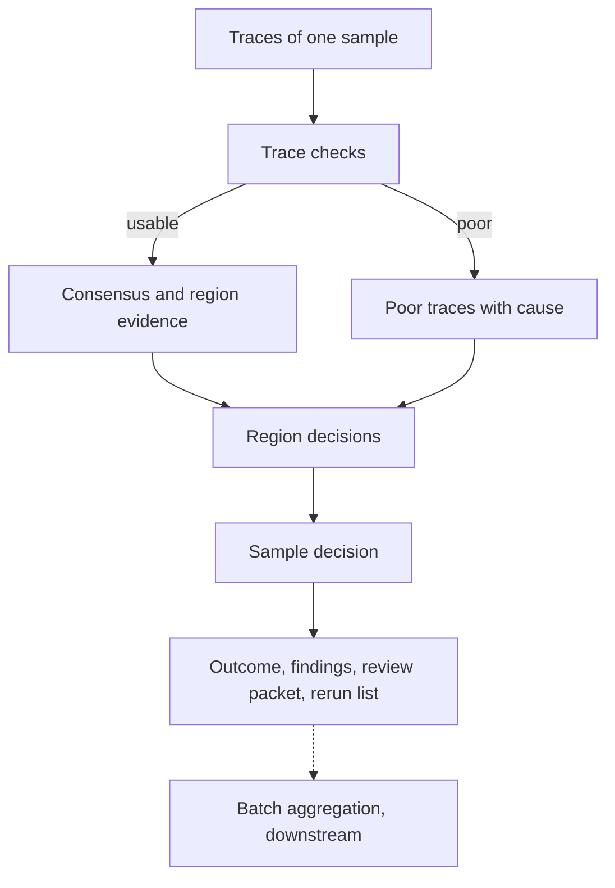
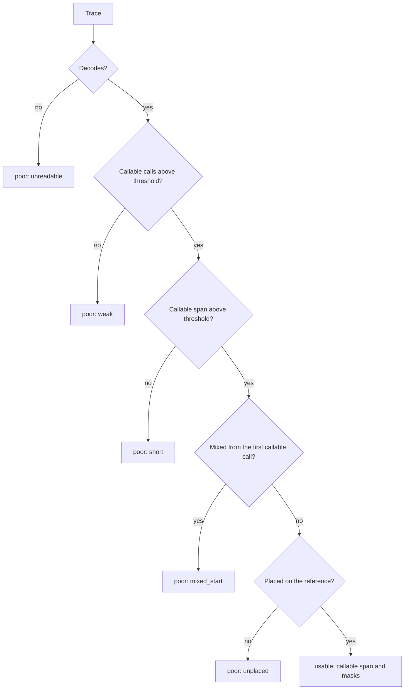
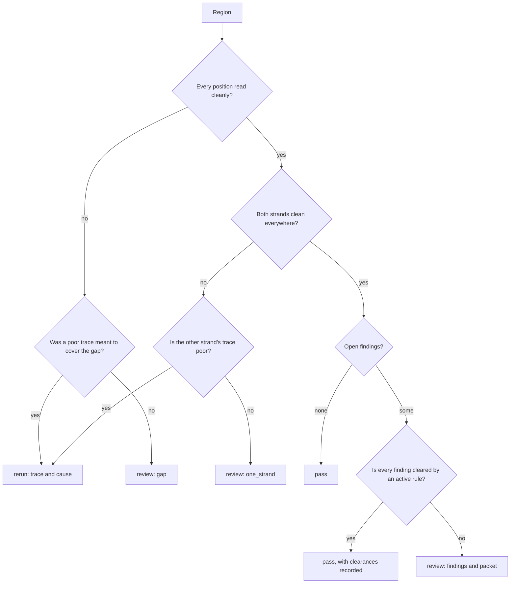
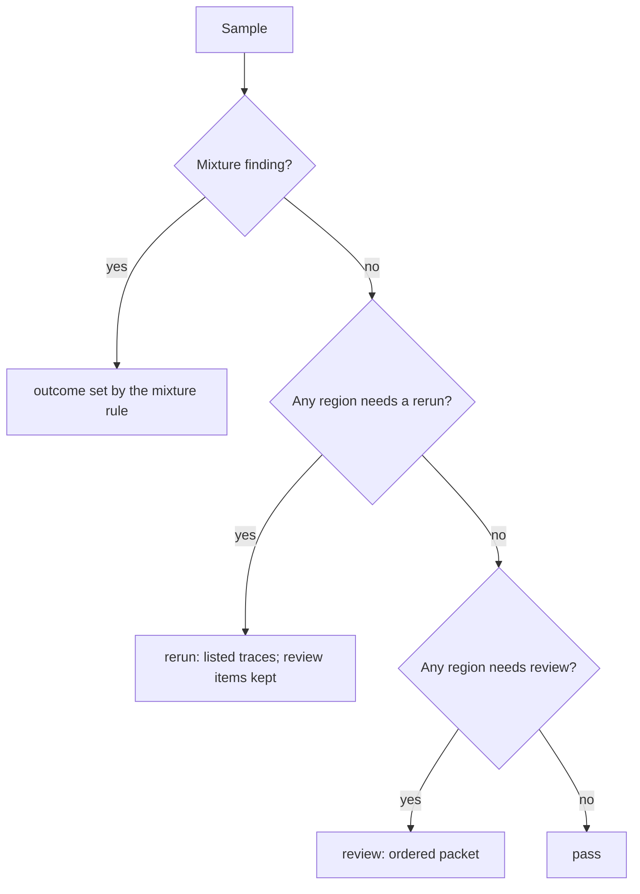
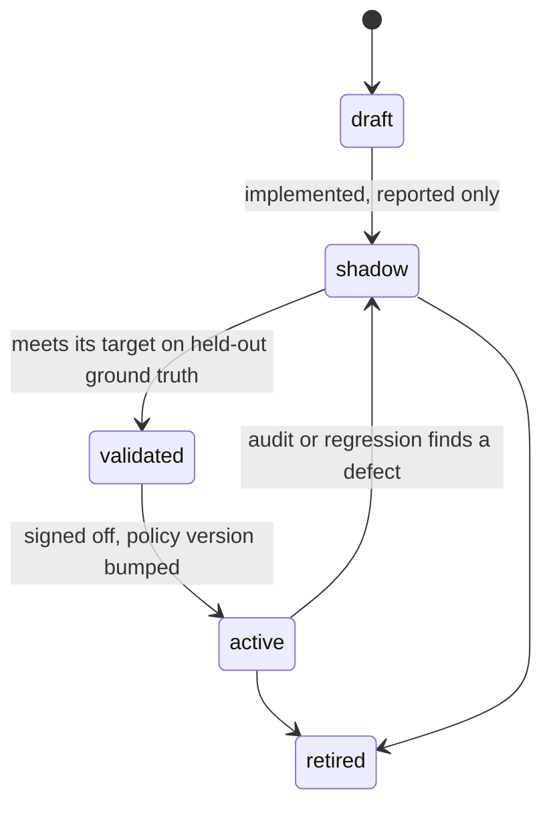

# Proposal: Review triage

## Problem

DNA's [purpose](../requirements/SRS.md#purpose) is to sort sequencing work
into pass, review, and rerun. Today DNA reports the evidence for each
decision but never the decision:

- **trace evidence** — callability, the callable span, rejected reads with a
  typed cause;
- **region evidence** — masked calls, eligibility reasons, opposition, and the
  consensus marks `N`, `contested`, `phase_loss`, `reference_frame`;
- **sample evidence** — coverage, overlaps, and the consensus variants.

So a reviewer still opens every sample. Nothing says which samples need no
look, which regions need one and why, and which traces should go back to the
lab.

This proposal designs the *system*: concepts, decision flow, rule approval,
determinism, and what each outcome must deliver. Biological rules such as
heteroplasmy and run lengths come later, as rules inside this system.

## Goals

Each outcome carries its own obligation:

- **Pass.** DNA resolves the result by itself. Every pass rests on evidence,
  and the rule behind it must be tested against ground truth and approved
  above a set threshold before it may act.
- **Review.** DNA cannot resolve the result, but a reviewer can settle it from
  the traces. DNA gives the reviewer the information and insight to decide:
  - what is uncertain;
  - the candidate answers;
  - the evidence for each candidate;
  - why no rule cleared it.

  A bare list of regions is not enough.
- **Rerun.** A trace is too poor or unreliable to settle anything. DNA
  detects the problem from evidence, against thresholds, and
  deterministically: the same trace always gets the same verdict and cause.

Across all three:

- measure A % (pass), B % (review), C % (rerun), and the error rate of passed
  results against ground truth;
- use these numbers to rank further work.

## Non-goals

- Biological interpretation rules. They plug into this system later as
  individual rules.
- Setting the lab's rerun rate. The chemistry sets it; DNA only detects it.
- Comparing results with reviewers or other tools. Downstream pipelines own
  comparison (ADR-0065).
- Batch decisions. Batch is the top level and comes last, and downstream
  pipelines aggregate it.
- Sample swaps. The data cannot show a swap.
- Checking that a sample has all its expected traces. Samples normally do.

## Evidence and research

- **[Review-triage research](../research/review-triage/README.md).** Clinical
  autoverification, selective classification, vendor trace metrics, and lab
  rerun practice.
- **DNA measurements on held-out reviewer truth.**
  - Unmasked calls are about 99.98 % right; errors cluster where reads
    dephase and where only one read is callable. Those places can already be
    told apart, so a cautious system can route them to review.
  - The consensus matches reviewers exactly on 297 of 320 evaluation samples.
    A passed sample must be exact, so A is at most that share until the
    consensus improves.

## Proposed design

### Concepts

| Concept | Meaning |
|---|---|
| **finding** | A typed fact DNA detects at one level and location, with the evidence values that triggered it. Example: "trace HV2F has 38 % callable calls, threshold 60 %". |
| **rule** | A named, versioned check. It either raises a finding, or clears one with evidence. Each rule has a lifecycle state. |
| **policy** | The set of active rules and their thresholds, with a version. It belongs to the configuration or target profile. |
| **outcome** | `pass`, `review`, or `rerun` for a region, trace, or sample, with its findings and the policy version. |

**Pass is an allow-list.** A region passes only when positive evidence is
present (every position read cleanly from both strands) and every finding is
cleared by an active rule. A finding type that no rule clears goes to review,
so a new or unknown problem can never pass silently.

### Finding catalogue

The catalogue is the first deliverable. Names are illustrative. Each finding
has a default outcome, and a rule may change that outcome only after it is
approved.

| Level | Finding | Detected from (today) | Default |
|---|---|---|---|
| trace | `unreadable` | ABIF decode failure | poor |
| trace | `weak` | too few callable calls (SRS-CALL-009) | poor |
| trace | `short` | callable span below threshold | poor |
| trace | `mixed_start` | mixed segment from the first callable call | poor |
| trace | `unplaced` | placement rejection (SRS-SAMPLE-029) | poor |
| region | `gap` | target position with no clean observation (consensus `N`) | review, or rerun if a poor trace was meant to cover it |
| region | `one_strand` | position read cleanly by one strand only | review, or rerun if the other strand's trace is poor |
| region | `conflict` | contested site, or a call opposed by a clean observation | review |
| region | `unread_run` | masked run, `phase_loss` or `reference_frame` length | review |
| region | `minor_signal` | second allele signal above threshold | review |
| region | `convention` | conformance finding | review |
| sample | `mixture` | traces of the sample disagree beyond a threshold | set by policy |

A *poor* trace is a diagnostic, not yet a rerun. A rerun is required only when
a region cannot pass or be reviewed without a better trace.

### Decision flow

The work goes from the lowest level up: region, then trace, then sample. The
batch level is aggregated downstream.

**Trace checks** run on one trace alone, so they can run as soon as the trace
exists:

**Region decision:**

**Sample decision.** The worst outcome wins, in the order
rerun > review > pass. Every finding is kept, so review items survive a rerun
request.

### Rule lifecycle and approval

Only an `active` rule changes an outcome. Every other state is reported but
does not act. DNA already worked this way when callability was observation
only first and acted only after measurement (ADR-0067).

Approval targets differ by outcome:

| Rule kind | Approval target on held-out ground truth | Also reported |
|---|---|---|
| pass (clears a finding) | zero known errors, and an upper bound on the error rate at or below the policy target | gain in A |
| rerun (marks a trace poor) | precision at or above the target: a flagged trace truly could not settle its region | recall; C |
| review (raises a finding) | none needed, because review is the safe default | share of items where DNA's leading candidate matched the reviewer |

Data discipline:

- **Tune** thresholds on a development set.
- **Approve** on a disjoint held-out set. Today these are the evaluation and
  fresh subsets.
- **Never tune on the approval set.** With zero errors in *n* passed samples,
  the 95 % upper bound on the error rate is about 3/*n*.
- **Audit after go-live.** Sample a share of passed results for audit review,
  so drift shows up as defects.

Each approval is a record of:

- the rule and its version;
- the dataset identity;
- the metrics;
- the approver and the date.

The record belongs with the release evidence (ADR-0018).

### Determinism

- **Reproducible.** The same traces, configuration, policy version, and DNA
  version give a byte-identical outcome.
- **Order-free.** The outcome does not depend on the order or file names of
  the traces. Property tests check this.
- **Exact thresholds.** Thresholds are fixed values with a documented
  comparison (`>=` or `>`) and rounding. A finding records the measured
  value, the threshold, and the margin between them, so near misses are
  visible.
- **Canonical order.** Findings and reasons are listed in a canonical order.

### Review packet

A review item tells the reviewer what to decide and gives the evidence for
it:

- **Question.** The location (region, site, or interval), and what is
  uncertain.
- **Candidates.** The possible answers, with DNA's leading candidate if it
  has one.
- **Evidence per candidate.** Which reads and strands support it, their
  quality, peak ratios, and callability state.
- **Why not passed.** Which finding is open, and which rules did not clear it
  and by what margin.
- **Where to look.** Trace names and scan positions, so a viewer can jump to
  the chromatogram.
- **Priority.** Items ordered by expected impact, for example a site that
  changes the haplotype before a convention note.

Reviewer answers, collected downstream as structured choices among the
candidates, become ground truth. That truth is what later promotes a review
rule to a pass rule, which is how B goes down.

### Rerun request

A rerun names:

- the trace;
- the cause (a finding code that the lab can map to an action such as
  re-inject, clean up again, or PCR again);
- the evidence values and thresholds;
- the regions that need the trace.

### Ownership and contract

- **Sanger plugin:** trace findings that depend on the chemistry.
- **Core:** region and sample decisions over the consensus and
  `ReadEvidence`, with no modality types.
- **Policy:** configuration or the target profile, versioned and recorded in
  every outcome.
- **Contract:** open. Either a `triage` section in `dna.consensus`, or a
  separate `dna.triage/v1` document from a `triage` command over a sample's
  results.

### Decisions so far

Agreed in review on 2026-10-14:

- the error catalogue comes first;
- the levels are region, trace, sample, and batch, worked from the bottom up;
- a pass normally needs both strands, with exceptions to be discussed;
- sample swaps and missing traces are out of scope;
- mixtures are detectable when the traces of a sample differ too much.

## Alternatives considered

- **Leave triage to downstream pipelines.** Rejected as the main path. A pass
  needs DNA's evidence types (masks, run structure, profiles), and downstream
  rules would copy them. Downstream still owns batch, controls, and
  comparison.
- **One score with a threshold.** Rejected. A score hides the reason, cannot
  name a rerun cause, cannot be approved rule by rule, and DNA's quality is
  not calibrated (SRS-QC-002).
- **Pass as "no finding raised" (deny-list).** Rejected. An unknown problem
  would pass. Pass needs positive evidence plus clearance (allow-list).
- **Sample-level outcomes only.** Rejected. Reviewers act on regions and the
  lab acts on traces.

## Validation plan

- **Phase 0, before any code.**
  - Build the finding catalogue from the ground-truth disagreements and the
    rejected reads of the evaluation and fresh subsets, with counts per
    finding.
  - A downstream research script applies the draft flow to the existing
    `dna consensus` and `dna sample` results. It reports A, B, and C, flagged
    sites per sample, errors that leak into pass, and truth sites that a pass
    would hide.

  This decides whether the system is worth building.
- **Per rule.** The approval targets above, on held-out ground truth.
- **System.** Property tests for determinism and order independence, and a
  regression check that the outcomes of the approval set do not change
  without a policy version bump.
- **After go-live.** An audit sample of passed results.

## Rollout and rollback

Outcomes are new output and do not change any call. Rules start in `shadow`
and act only after approval. Rollback means returning a rule to `shadow`, or
not emitting outcomes.

## Observability and operations

Outcome and finding counts go to the operational log. Batch summaries and
audit sampling belong to downstream pipelines.

## Security and privacy

No new trust boundary. ABIF run and well identity are lab metadata and follow
the [data policy](../governance/data.md).

## Compatibility and migration

New contract fields or a new document version; no migration is needed.

## Open questions

1. What error-rate target and confidence should pass rules meet, and how many
   ground-truth samples does that need?
2. Who signs off a rule, and where does the approval record live?
3. Which share of passed results goes to audit after go-live?
4. A triage section in `dna.consensus`, or a separate document and command?
5. Should trace checks run before the sample is complete, as a trace-level
   command?
6. Which exceptions, if any, allow a region read by one strand to pass?
7. How far must the traces of one sample disagree to count as a mixture, and
   is a mixture a review or a rerun?

## Decision

Not yet reviewed.

## Implementation

None.
