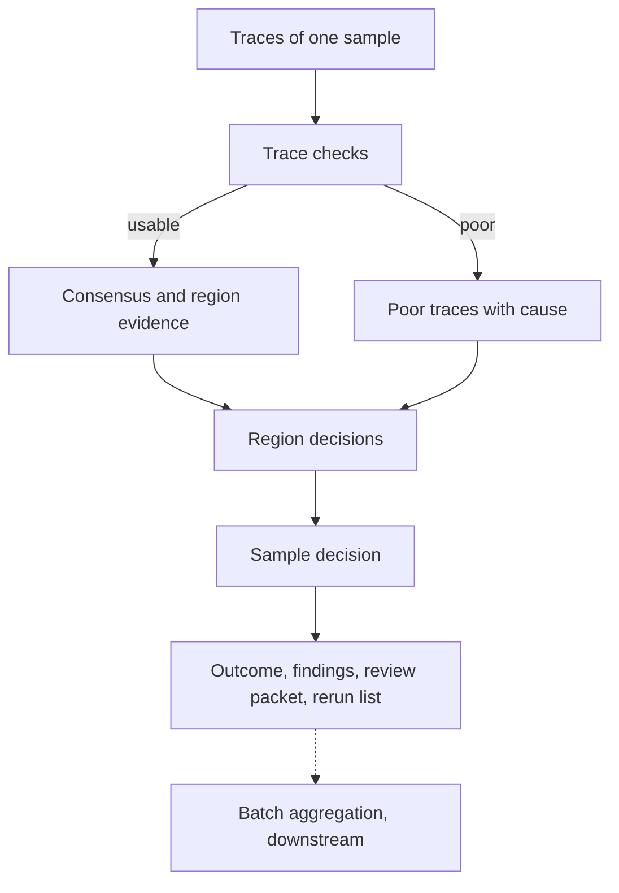
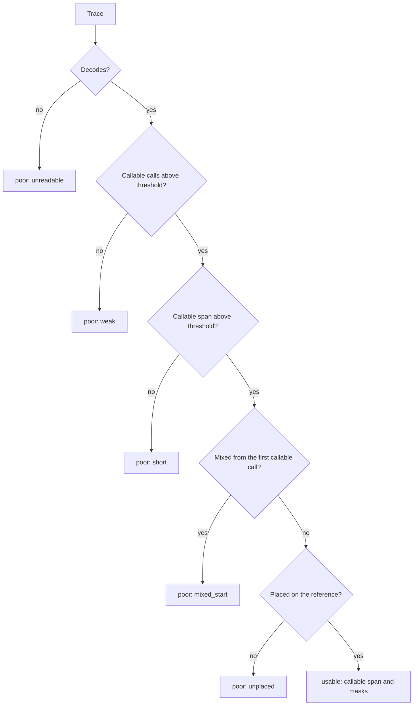
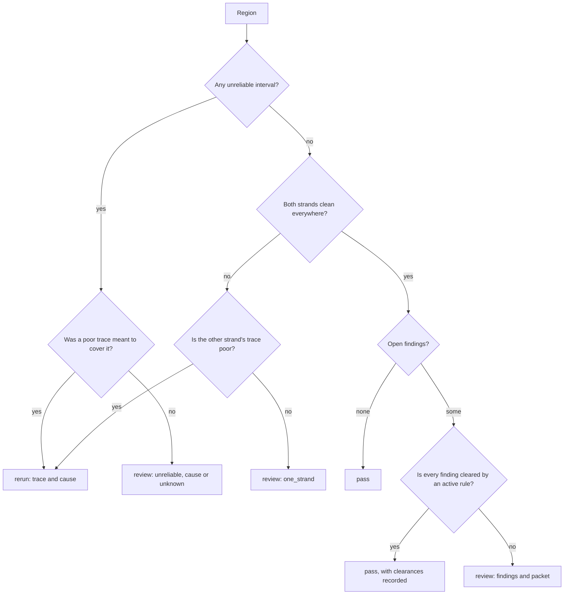
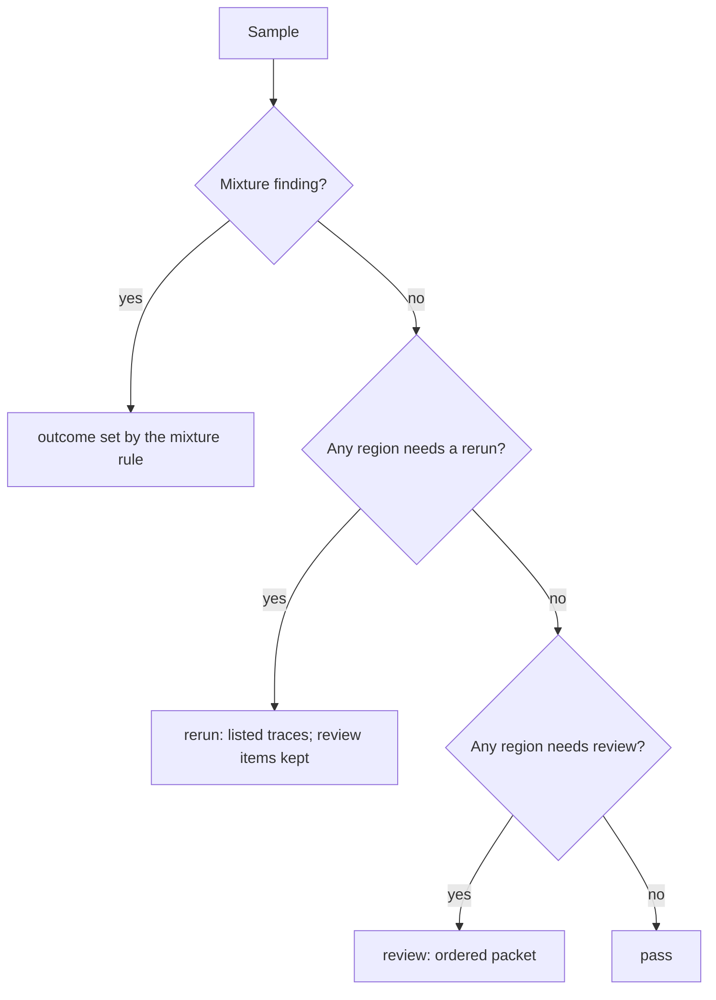
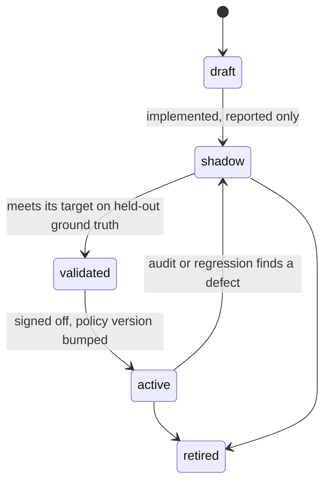

# Proposal: Review triage

## Problem

DNA's [purpose](../requirements/SRS.md#purpose) is to sort sequencing work
into pass, review, and rerun. Today DNA reports the evidence for each
decision but never the decision:

- **trace evidence** — callability, the callable span, rejected reads with a
  typed cause;
- **region evidence** — masked calls, eligibility reasons, opposition, and the
  consensus marks `N`, `contested`, `phase_loss`, `reference_frame`;
- **sample evidence** — coverage, overlaps, and the consensus variants.

So a reviewer still opens every sample. Nothing says which samples need no
look, which regions need one and why, and which traces should go back to the
lab.

This proposal designs the *system*: concepts, decision flow, rule approval,
determinism, and what each outcome must deliver. Biological rules such as
heteroplasmy and run lengths come later, as rules inside this system.

## Goals

Each outcome carries its own obligation:

- **Pass.** DNA resolves the result by itself. Every pass rests on evidence,
  and the rule behind it must be tested against ground truth and approved
  above a set threshold before it may act.
- **Review.** DNA cannot resolve the result, but a reviewer can settle it from
  the traces. DNA gives the reviewer the information and insight to decide:
  - what is uncertain;
  - the candidate answers;
  - the evidence for each candidate;
  - why no rule cleared it.

  A bare list of regions is not enough.
- **Rerun.** A trace is too poor or unreliable to settle anything. DNA
  detects the problem from evidence, against thresholds, and
  deterministically: the same trace always gets the same verdict and cause.

Across all three:

- measure A % (pass), B % (review), C % (rerun), and the error rate of passed
  results against ground truth;
- use these numbers to rank further work.

The evaluation method and the fast feedback loop are in
[PROP-0005](0005-evaluation-feedback-loop.md).

## Non-goals

- Biological interpretation rules. They plug into this system later as
  individual rules.
- Setting the lab's rerun rate. The chemistry sets it; DNA only detects it.
- Comparing results with reviewers or other tools inside the triage rules.
  Comparison belongs to the evaluation harness
  ([PROP-0005](0005-evaluation-feedback-loop.md)).
- Batch decisions. Batch is the top level and comes last, and downstream
  pipelines aggregate it.
- Sample swaps. The data cannot show a swap.
- Checking that a sample has all its expected traces. Samples normally do.

## Evidence and research

- **[Review-triage research](../research/review-triage/README.md).** Clinical
  autoverification, selective classification, vendor trace metrics, and lab
  rerun practice.
- **DNA measurements on held-out reviewer truth.**
  - Unmasked calls are about 99.98 % right; errors cluster where reads
    dephase and where only one read is callable. Those places can already be
    told apart, so a cautious system can route them to review.
  - The consensus matches reviewers exactly on 297 of 320 evaluation samples.
    A passed sample must be exact, so A is at most that share until the
    consensus improves.

## Proposed design

### Concepts

| Concept | Meaning |
|---|---|
| **error** | A difference between DNA's final result and the ground truth at one site or interval. Only an evaluation can see it, because it needs the truth. |
| **unreliable region** | An interval where DNA's own evidence does not support a confident answer. DNA detects it without the truth. |
| **finding** | A typed record that a rule raised: level, location, cause (possibly `unknown`), and the evidence values against their thresholds. |
| **rule** | A named, versioned, deterministic function from evidence to findings (a *detector*), or from a finding and its evidence to a clearance (a *resolver*). |
| **policy** | The active rules, their parameters, and their outcome mapping, with one version. |
| **outcome** | `pass`, `review`, or `rerun` for a region, trace, or sample, with its findings and the policy version. |

**Pass is an allow-list.** A region passes only when positive evidence is
present (every position read cleanly from both strands) and every finding is
cleared by an active resolver. A finding that no resolver clears goes to
review, so a new or unknown problem can never pass silently.

### Error model: detect first, diagnose later

DNA does not need to know what went wrong before it knows *where* it cannot
be trusted. The model has two stages.

1. **Detection.** Detectors mark unreliable regions and poor traces. Every
   such region carries the cause `unknown` unless a detector knows better. A
   region that no detector marks is reliable.
2. **Diagnosis.** Once an unreliable region is caught, more specific
   detectors give it a cause (dephasing, a single strand, conflicting reads,
   and so on). A cause makes the review packet richer and may let a resolver
   clear the region. It never makes an unmarked region unreliable after the
   fact.

Stage 1 alone already reaches the purpose:

- reliable regions pass;
- unreliable regions go to review;
- poor traces that a region needs go to rerun.

Stage 2 lowers B over time.

The evaluation scores the stages separately ([PROP-0005](0005-evaluation-feedback-loop.md)):

- **Detection quality.** Every error must lie inside an unreliable region.
  An error outside is a *leak*. Unreliable regions without an error are review
  burden.
- **Diagnosis quality.** The cause assigned to a caught error matches the
  cause found by inspection.

**Error classes.** An error is classified on three independent axes, not one
flat list.

| Axis | Values | Who sets it |
|---|---|---|
| level | trace, region, sample (batch downstream) | the detector |
| origin | `signal` (chemistry, input), `method` (a DNA limit or bug), `biology` (a real state such as heteroplasmy), `truth` (reviewer convention or reviewer error), `unknown` | diagnosis; `unknown` until known |
| action | `resolvable` (a resolver can clear it), `reviewable` (a reviewer can settle it), `rerun` (no one can settle it from this trace) | the policy, per cause |

Notes on the axes:

- **Origin `method`** errors are DNA's own work list. They are fixed in DNA,
  not in triage.
- **Origin `truth`** errors are not counted against DNA after adjudication.
- **A representation-only difference** (the same haplotype written another
  way) is not an error. The evaluation normalises notation first.

### Rule model

A rule is Rust code with a declarative description. A text rule language
would add an interpreter and still need Rust for the evidence types, so there
is none.

| Part | Content |
|---|---|
| identity | stable `id` (`region.one_strand`), integer `version`, owning crate (Sanger plugin for chemistry, core otherwise) |
| kind | `detector` (evidence → findings) or `resolver` (finding + evidence → clearance) |
| level | trace, region, or sample |
| inputs | the evidence fields it reads; only typed evidence, never file paths or truth |
| parameters | named thresholds with type, unit, allowed range, and comparison (`>=` or `>`), loaded from strict configuration |
| output | findings with cause, location, and for every parameter the measured value, threshold, and margin |
| status | `draft`, `shadow`, `validated`, `active`, or `retired`, set by the policy, not by the code |
| tests | synthetic-evidence unit tests at, just above, and just below each threshold |

Contract for every rule:

- **Pure and deterministic.** No I/O, clock, randomness, or global state. The
  result does not depend on trace order.
- **Bounded.** Work grows linearly with the evidence it reads.
- **Cheap.** Rules run on evidence that is already computed, never on raw
  signal again. Rule iteration then needs no re-alignment
  ([PROP-0005](0005-evaluation-feedback-loop.md)).
- **Bumped on change.** A changed rule gets a new version, and a changed
  parameter value gets a new policy version. Each outcome records both.

The registry lists every rule once, like the plugin registry (ADR-0069), and
is checked at compile time: ids are unique, and a parameter belongs to exactly
one rule. The policy file only switches status and sets parameter values.

### Finding catalogue

The catalogue is the first deliverable. Names are illustrative. Each
detector starts with cause `unknown` or a cause it can see directly.

| Stage | Level | Finding | Detected from (today) | Default outcome |
|---|---|---|---|---|
| 1 | trace | `trace.unreadable` | ABIF decode failure | poor |
| 1 | trace | `trace.weak` | too few callable calls (SRS-CALL-009) | poor |
| 1 | trace | `trace.short` | callable span below threshold | poor |
| 1 | trace | `trace.unplaced` | placement rejection (SRS-SAMPLE-029) | poor |
| 1 | region | `region.unreliable` | masked call, consensus `N`, `contested`, `phase_loss`, or `reference_frame`, with cause `unknown` | review |
| 1 | region | `region.one_strand` | position read cleanly by one strand only | review, or rerun if the other strand's trace is poor |
| 2 | trace | `trace.mixed_start` | mixed segment from the first callable call | poor |
| 2 | region | `region.conflict` | a call opposed by a clean observation | review |
| 2 | region | `region.unread_run` | a run whose length no read shows | review |
| 2 | region | `region.minor_signal` | second allele signal above threshold | review |
| 2 | region | `region.convention` | conformance finding | review |
| 2 | sample | `sample.mixture` | traces of the sample disagree beyond a threshold | set by policy |

A *poor* trace is a diagnostic, not yet a rerun. A rerun is required only when
a region cannot pass or be reviewed without a better trace.

### Decision flow

The work goes from the lowest level up: region, then trace, then sample. The
batch level is aggregated downstream.

**Trace checks** run on one trace alone, so they can run as soon as the trace
exists:

**Region decision:**

**Sample decision.** The worst outcome wins, in the order
rerun > review > pass. Every finding is kept, so review items survive a rerun
request.

### Rule lifecycle and approval

Only an `active` rule changes an outcome. Every other state is reported but
does not act. DNA already worked this way when callability was observation
only first and acted only after measurement (ADR-0067).

Approval targets differ by outcome:

| Rule kind | Approval target on held-out ground truth | Also reported |
|---|---|---|
| pass (clears a finding) | zero known errors, and an upper bound on the error rate at or below the policy target | gain in A |
| rerun (marks a trace poor) | precision at or above the target: a flagged trace truly could not settle its region | recall; C |
| review (raises a finding) | none needed, because review is the safe default | share of items where DNA's leading candidate matched the reviewer |

Datasets, splits, and the metrics behind these targets are defined in
[PROP-0005](0005-evaluation-feedback-loop.md). After go-live, a share of
passed results is sampled for audit review, so drift shows up as defects.

Each approval is a record of:

- the rule and its version;
- the dataset identity;
- the metrics;
- the approver and the date.

The record belongs with the release evidence (ADR-0018).

### Determinism

- **Reproducible.** The same traces, configuration, policy version, and DNA
  version give a byte-identical outcome.
- **Order-free.** The outcome does not depend on the order or file names of
  the traces. Property tests check this.
- **Exact thresholds.** Thresholds are fixed values with a documented
  comparison (`>=` or `>`) and rounding. A finding records the measured
  value, the threshold, and the margin between them, so near misses are
  visible.
- **Canonical order.** Findings and reasons are listed in a canonical order.

### Review packet

A review item tells the reviewer what to decide and gives the evidence for
it:

- **Question.** The location (region, site, or interval), and what is
  uncertain.
- **Candidates.** The possible answers, with DNA's leading candidate if it
  has one.
- **Evidence per candidate.** Which reads and strands support it, their
  quality, peak ratios, and callability state.
- **Why not passed.** Which finding is open, and which rules did not clear it
  and by what margin.
- **Where to look.** Trace names and scan positions, so a viewer can jump to
  the chromatogram.
- **Priority.** Items ordered by expected impact, for example a site that
  changes the haplotype before a convention note.

Reviewer answers, collected downstream as structured choices among the
candidates, become ground truth. That truth is what later promotes a review
rule to a pass rule, which is how B goes down.

### Rerun request

A rerun names:

- the trace;
- the cause (a finding code that the lab can map to an action such as
  re-inject, clean up again, or PCR again);
- the evidence values and thresholds;
- the regions that need the trace.

### Ownership and contract

- **Sanger plugin:** trace findings that depend on the chemistry.
- **Core:** region and sample decisions over the consensus and
  `ReadEvidence`, with no modality types.
- **Policy:** configuration or the target profile, versioned and recorded in
  every outcome.
- **Contract:** open. Either a `triage` section in `dna.consensus`, or a
  separate `dna.triage/v1` document from a `triage` command over a sample's
  results.

### Decisions so far

Agreed in review on 2026-10-14:

- the error catalogue comes first;
- the levels are region, trace, sample, and batch, worked from the bottom up;
- a pass normally needs both strands, with exceptions to be discussed;
- sample swaps and missing traces are out of scope;
- mixtures are detectable when the traces of a sample differ too much;
- when the error is not yet known, detect the unreliable region first and
  diagnose the error later;
- rules are measured against about 100,000 samples with reviewer results,
  with a fast feedback loop (PROP-0005).

## Alternatives considered

- **Leave triage to downstream pipelines.** Rejected as the main path. A pass
  needs DNA's evidence types (masks, run structure, profiles), and downstream
  rules would copy them. Downstream still owns batch, controls, and
  comparison.
- **One score with a threshold.** Rejected. A score hides the reason, cannot
  name a rerun cause, cannot be approved rule by rule, and DNA's quality is
  not calibrated (SRS-QC-002).
- **Pass as "no finding raised" (deny-list).** Rejected. An unknown problem
  would pass. Pass needs positive evidence plus clearance (allow-list).
- **Sample-level outcomes only.** Rejected. Reviewers act on regions and the
  lab acts on traces.

## Validation plan

- **Phase 0, before any production code.** Stage 1 detectors from today's
  evidence, measured with the method of
  [PROP-0005](0005-evaluation-feedback-loop.md). The leak and A/B/C numbers
  decide whether the system is worth building. Results below.
- **Per rule.** The approval targets above, on held-out ground truth.
- **System.** Property tests for determinism and order independence, and a
  regression check that the outcomes of the approval set do not change
  without a policy version bump.
- **After go-live.** An audit sample of passed results.

### Phase 0 results

Measured on 2026-10-15 with the draft triage of the evaluation harness
(`dna-eval run --triage`,
[draft triage](../validation/evaluation-harness.md#draft-triage)) on the
development panel v3: 2,618 active samples, revision 6a84daa plus the draft,
truth unchanged. The detectors are drafts in the harness, not DNA rules.

**Draft policy.** `trace.short` below 100 calls; `region.unreliable` for `N`,
`contested`, `masked` sites, `phase_loss`, and `reference_frame`;
`region.one_strand`; `region.gap`; a poor trace is asked for by a rerun when
its primer (from the trace name) reads the region on a missing strand.

**A/B/C.**

| Level | Pass | Review | Rerun |
|---|---:|---:|---:|
| samples | 515 (19.7 %) | 2,025 (77.4 %) | 78 (3.0 %) |
| samples, corpus-weighted | 0.178 ± 0.023 | 0.799 ± 0.023 | 0.023 ± 0.006 |
| regions (HVS-I, HVS-II, HVS-III) | 42.9 % (40.0, 36.6, 52.0) | 55.4 % | 1.7 % |

No sample failed. The clean stratum passes 36 %; the poly-C strata pass
almost nothing (`16189C` 3 %, `309.2C` 1 %), and samples with missing traces
none.

**Leaks** (passed samples that are not concordant; one-sided 95 %
Clopper–Pearson upper bound):

| Measure | Leaks / passed | Rate | Upper bound | Corpus-weighted |
|---|---:|---:|---:|---:|
| primary | 50 / 515 | 0.097 | 0.121 | 0.055 |
| strict | 50 / 515 | 0.097 | 0.121 | 0.055 |
| IUPAC-compatible | 9 / 515 | 0.017 | 0.030 | 0.002 |

What leaks is invisible to stage-1 evidence:

- **Heteroplasmy.** 41 of the 50 primary leaks differ only at truth IUPAC
  alleles that both strands read cleanly, where the consensus calls one base.
- **Representation.** The other 9 differ only in how a clean haplotype is
  written or placed: HVS-I poly-C length variants at other positions
  (5 samples), an HVS-II poly-C insertion (1), `248DEL` against `249DEL` with an
  AC-repeat deletion (1), and one sample whose truth positions in HVS-I are
  shifted by one against DNA's (to adjudicate).
- **Region leaks** follow the same pattern: of the 301 primary discordant
  positions inside passed regions, most lie in the HVS-I poly-C window
  (16180–16195), insertions and substitutions written at other positions.

**Detectors** (over 658 primary not-concordant samples; unique = flagged by
no other applied detector; sole burden = concordant samples that pass once
the detector is cleared):

| Detector | Samples | Catches | Unique | Burden | Sole burden |
|---|---:|---:|---:|---:|---:|
| `region.one_strand` | 1,921 | 554 | 9 | 1,367 | 118 |
| `region.unreliable:masked` | 1,753 | 550 | 8 | 1,203 | 56 |
| `region.gap` | 1,236 | 480 | 0 | 756 | 9 |
| `region.unreliable:n` | 1,157 | 469 | 0 | 688 | 0 |
| `region.unreliable:reference_frame` | 481 | 124 | 0 | 357 | 0 |
| `region.unreliable:phase_loss` | 142 | 40 | 0 | 102 | 0 |
| `region.unreliable:contested` | 53 | 20 | 6 | 33 | 3 |

- **One strand** covers whole halves of a region in samples with poly-C
  length heteroplasmy (`16189C`, `309.1C`/`309.2C`): each read dephases at the
  poly-C, so the far side is read by the opposite primer only. Region starts
  at the primer ends (16024–16031, 73–80) give gaps and one-strand
  positions.
- **Nested causes.** Every sample that `N`, `phase_loss`, or
  `reference_frame` flags is flagged by another detector too (an `N` position
  is a gap), so they add no catch; they are diagnosis causes rather than
  stage-1 detectors.
- **Poor traces.** 92 poor traces, 87 asked for by a rerun. Most traces with
  a callable span under 200 calls are HV1F traces whose span ends near the
  HVS-I poly-C (150–250 calls), so `trace.short` at 200 calls sends 27 % of
  samples to rerun for a length heteroplasmy a rerun cannot fix; at 100 calls
  2.3 %.

**Sweep** (risk–coverage; corpus-weighted A, leaks over passed samples):

| Policy | A | Primary leaks (bound) | IUPAC-compatible leaks (bound) |
|---|---:|---:|---:|
| draft | 0.178 | 50 / 515 (0.121) | 9 / 515 (0.030) |
| `region.one_strand` off | 0.237 | 59 / 642 (0.113) | 11 / 642 (0.028) |
| `masked` off | 0.220 | 58 / 579 (0.123) | 13 / 579 (0.036) |
| one-strand and `masked` off | 0.418 | 120 / 1,047 (0.132) | 36 / 1,047 (0.045) |
| gap only | 0.504 | 178 / 1,382 (0.145) | 71 / 1,382 (0.062) |

`trace.short` and the proxy move samples only between review and rerun
(C 0.008 with the detector off, 0.023 at 100, 0.270 at 200 calls; the `any`
proxy adds 0.0002).

**Speed.** The panel run with the draft triage takes 7–11 s on 32–64
threads; deciding and scoring all 14 policies takes 1–2 s. Outputs are
byte-identical between thread counts, and the run without `--triage` is
unchanged.

**Conclusion.** Stage 1 is worth building as the detection layer, but not on
its own as the pass rule:

- **Its leaks are not stage-1 errors.** Every leak is heteroplasmy or a
  representation difference, neither of which stage-1 evidence can show. A
  pass rule therefore needs, before approval: notation normalisation in the
  comparison (or an HVS-I poly-C nomenclature window) so representation stops
  counting, and a minor-signal detector (`region.minor_signal`) as a pass
  gate.
- **Its A is too low.** About 18 % corpus-weighted. The largest lever is a
  one-strand resolver for poly-C dephasing (open question 6), then region
  edges at the primer ends.
- **Detectors first:** `region.gap`, `region.unreliable` for `N` and
  `contested` (the best catches per burden), `region.one_strand`, and the
  trace rejections. `masked` sites second, with their burden measured.
  `phase_loss` and `reference_frame` serve diagnosis. `trace.short` at
  100 calls or off, with the primer proxy for reruns.

## Rollout and rollback

Outcomes are new output and do not change any call. Rules start in `shadow`
and act only after approval. Rollback means returning a rule to `shadow`, or
not emitting outcomes.

## Observability and operations

Outcome and finding counts go to the operational log. Batch summaries and
audit sampling belong to downstream pipelines.

## Security and privacy

No new trust boundary. ABIF run and well identity are lab metadata and follow
the [data policy](../governance/data.md).

## Compatibility and migration

New contract fields or a new document version; no migration is needed.

## Open questions

1. What error-rate target and confidence should pass rules meet, and how many
   ground-truth samples does that need?
2. Who signs off a rule, and where does the approval record live?
3. Which share of passed results goes to audit after go-live?
4. A triage section in `dna.consensus`, or a separate document and command?
5. Should trace checks run before the sample is complete, as a trace-level
   command?
6. Which exceptions, if any, allow a region read by one strand to pass?
7. How far must the traces of one sample disagree to count as a mixture, and
   is a mixture a review or a rerun?

## Decision

Not yet reviewed.

## Implementation

None in DNA. Phase 0 is measured with draft detectors in the evaluation
harness (`dna-eval run --triage`); they are research and not rules of this
system.
