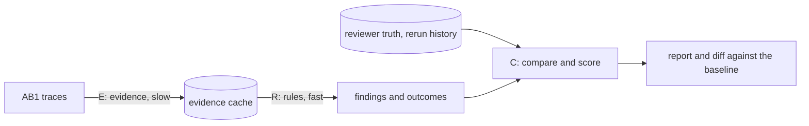

# Proposal: Evaluation method and fast feedback loop

## Problem

[PROP-0004](0004-review-triage.md) lets a rule act only after ground truth
has validated it. The lab has about 100,000 samples with raw traces and
reviewer results. Such a corpus can support strong claims, but only if two
things exist:

- **A method.** Fixed labels, splits, metrics, and reports, so that a number
  means the same thing in every run.
- **A fast loop.** Changing a threshold and seeing its effect must take
  seconds to minutes, not a day.

DNA is Rust and runs on a 256-core server. One run is not the bottleneck;
recomputing everything on every change is.

**Measured on 2026-10-14** (release build of main, one thread per process):

| Command | Wall time | Peak memory |
|---|---|---|
| `basecall` on one trace | 0.07 s | 5 MB |
| `analyze` on one trace | 1.9 s | 34 MB |
| `consensus` on one sample (4 traces) | 4.7 s | 52 MB |
| `sample` on the same sample | 4.6 s | 52 MB |

- **Placement dominates.** Reference placement takes about 95 % of the time.
- **Placement runs twice.** `sample` and `consensus` each place every trace
  again.
- **Scale.** 100,000 samples take about 130 CPU-hours per command. That is
  about 30 minutes on 256 cores at best, and today every rule change would
  repeat it.

## Goals

- **One method.** An evaluation method that defines labels, splits, metrics,
  and reports for detection, diagnosis, rerun, and per-rule approval.
- **Reproducible reports.** The same DNA revision, policy version, and dataset
  manifest always give the same report.
- **Loop budgets** on the server:

| Change | Scope | Budget |
|---|---|---|
| rule parameter or rule code | development panel | under 10 s |
| rule parameter or rule code | validation panel | under 1 min |
| evidence algorithm (DNA itself) | validation panel | under 10 min |
| any, before a release | full corpus | a scheduled run, not part of the loop |

## Non-goals

- Moving truth formats or comparison into DNA without a decision. ADR-0065
  keeps them out today. The options below make that choice explicit.
- A review user interface.
- Biological rules. They are the subject of the loop, not of this proposal.

## Proposed design

### Three stages with a cache between them

- **Stage E (evidence).** Decoding, base calling, callability, placement, and
  consensus, per trace and per sample. This stage is expensive. Its output is
  cached under a key made of:
  - the SHA-256 of the trace bytes;
  - the evidence version (plugin versions, the hash of the evidence-relevant
    configuration, the reference checksum).

  Rule parameters are not part of the key, so a rule change never invalidates
  the cache.
- **Stage R (rules).** The pure rules of PROP-0004 run over cached evidence.
  They take microseconds to milliseconds per sample and run in parallel
  across samples.
- **Stage C (compare).** Outcomes are compared with the truth, then scored,
  reported, and diffed against a stored baseline run.

The loop then splits by what changed:

| What changed | Stages re-run |
|---|---|
| rule parameter or rule code | R and C only |
| DNA evidence code | E, R, and C |
| truth adjudication | C only |

### What DNA provides

DNA stays free of truth and comparison. To make the loop possible it
provides:

- **Library calls.** A public call that computes a sample's triage evidence
  in process, and a separate call that runs the rule layer on such evidence
  (SRS-API).
- **An evidence record.** A versioned, serialisable record that holds exactly
  what the rules read, so a cache can store it. Whether this is a new compact
  record or the existing `dna.consensus` and `dna.sample_evidence` documents is
  open.
- **Placement once per trace.** One in-process call yields both the sample
  evidence and the consensus.
- **Faster placement.** Seed the placement with reference k-mers, then align
  in a band. Maintained implementations are evaluated first (SRS-NFR-006).
  This is a measured change: placements must stay identical on the corpus, or
  the changes must be explained.

### Where the harness lives

| Option | For | Against |
|---|---|---|
| **A. Separate Rust repository** (chosen), depending on DNA's crates by path or git revision | Keeps ADR-0065 and ADR-0066. Calls DNA in process with no process start or JSON parse per stage. Owns truth adapters, manifests, cache, the parallel runner, and reports. | DNA and the harness are versioned separately. Local work needs a path dependency on the DNA checkout. |
| **B. Crate in the DNA workspace**, outside the `dna` binary | One change spans both, and the loop is the tightest. | Brings lab truth formats and comparison into DNA, so it needs an ADR that supersedes ADR-0065. |
| **C. `mtdna_raw` (Python) drives the CLI** | Nothing new to build. | A process per sample, JSON on every stage, and every rule change re-runs the CLI, so the loop budgets cannot be met. |

### Evaluation method

**Truth and normalisation.**

- **What counts.** The reviewer variants of each sample, inside the analysed
  intervals. IUPAC sites are scored on their own.
- **Same notation on both sides.** Both sides pass through DNA's notation
  plugin, called as a library. A difference in writing alone is then never
  an error.

**Labels.**

| Label | Definition |
|---|---|
| site error | false call, missed call, wrong allele, or wrong length at a truth site or DNA call |
| sample exact | no site error in the sample |
| error caught | the site lies inside an unreliable region or a region not passed |
| leak | a site error inside a passed region |
| rerun positive | a trace that the lab's rerun history replaced |
| rerun negative | a trace of a sample whose reviewed result needed no rerun |

The rerun history is the set of rerun lists that record which trace each
rerun replaced. The lab's own rerun decisions are noisy, so these labels are
a proxy.

**Metrics.**

| Area | Metrics |
|---|---|
| detection (stage 1) | leaks; passed-sample error rate with its Clopper–Pearson 95 % upper bound; burden as unreliable bases and flagged sites per sample; A/B/C at sample and region level |
| trade-off | risk–coverage curve: passed-sample error rate against A over a threshold sweep |
| diagnosis (stage 2) | confusion matrix of assigned against inspected cause, on an inspected sample of caught errors |
| rerun | precision and recall against the rerun history |
| per rule | unique catches, false flags, and the change in every metric when the rule is removed (ablation) |
| stability | samples whose outcome changed against the baseline, listed |

**Test panels.** The loop does not run on all 100,000 samples. It runs on
small, fixed panels, each with a manifest and its hash. A panel holds two
kinds of samples:

- **Anchors.** Samples whose result is exact and stays exact from run to run.
  They catch regressions: an anchor that changes is a failure to explain.
- **Problem samples.** Enriched by stratum, so each known difficulty has
  enough cases. Examples:
  - disagreement between the older pipeline and the truth;
  - IUPAC truth sites;
  - length variants in poly-C windows;
  - rare variants;
  - rerun history;
  - known DNA errors.

The panels:

| Panel | Size | Use |
|---|---|---|
| development | about 1,000–3,000 | every change, seconds |
| validation | about 10,000 | tuning and confirmation, minutes |
| hold-out | whole batches, including the most recent | rule approval only; never used to tune |
| full corpus | all samples with raw traces | scheduled release and drift runs |

Panel rules:

- **Deterministic selection.** Within each stratum, samples are taken in
  order of the hash of the sample id.
- **Weights.** Each stratum carries the inverse of its sampling share. The
  enriched panel can then still estimate corpus rates (A, error rate of
  passed results) without bias.
- **Refreshing.** A refresh adds a new manifest version and keeps the
  previous version runnable, so numbers stay comparable across versions.

**Panel v1 (built 2026-10-14, outside the repository).**

Inventory:

- the truth holds 103,418 samples;
- 97,306 of them have raw traces, and 96,841 have all of HV1, HV2, and HV3.

Each sample goes to the first stratum it matches. The strata use only
information that needs no DNA run, so their weights hold for the whole
corpus.

| Stratum (first match) | Corpus | Dev | Baseline not exact |
|---|---:|---:|---:|
| partial traces | 465 | 120 | 0.93 (mostly missing traces, not call errors) |
| reviewer flag or short range | 1,720 | 120 | 0.29 |
| HVS-I length variant | 462 | 150 | 0.60 |
| unusual HVS-II length | 1,196 | 150 | 0.17 |
| IUPAC truth site | 8,371 | 200 | 0.17 |
| rare variant | 351 | 150 | 0.22 |
| older pipeline disagrees, point | 6,582 | 200 | 0.30 |
| older pipeline disagrees, repeat window | 9,629 | 150 | 0.18 |
| resequenced | 4,018 | 150 | 0.25 |
| 309.2C | 12,263 | 150 | 0.23 |
| 16189C | 14,943 | 150 | 0.15 |
| clean | 37,306 | 300 | 0.01 |

What the strata show:

- **They separate difficulty.** Clean samples fail 1 % of the time; the
  enriched strata fail 15–60 %.
- **Corpus estimate.** Weighted, the baseline not-exact rate is 0.135 ± 0.016
  (95 %). Unweighted, the panel gives 0.258.

The panels:

- **Development panel.** 1,990 stratified samples, plus 630 earlier
  evaluation samples kept at zero weight.
- **Anchors.** Clean samples on which the older pipeline agrees with the
  truth. 294 of 297 were exact in the baseline. Two repeated runs gave
  identical results.
- **Validation and hold-out panel.** 115 whole batches with 10,109 samples:
  - all batches from the most recent reviewed weeks that were not used for
    tuning;
  - batches drawn by hash.

  It is not run until approval.

Measured run time for `consensus` plus `call`, about 6.3 CPU-seconds per
sample:

| Set | CPU-hours | 64 workers | 200 workers |
|---|---:|---:|---:|
| development (2,620) | 4.7 | 4.5 min (measured) | about 1.5 min |
| validation (10,109) | 18 | about 17 min | about 6 min |
| full traced corpus (97,306) | 175 | about 2.8 h | about 55 min |

**Faster placement (2026-10-14, PR #51, in review).** Four exact changes
keep every result byte-identical to the current release on 299 samples
(both `consensus` and `sample`) and on a separate check of 40 panel samples:

- a single-pass Gotoh kernel (about 4× per cell);
- seeded q-gram pruning that tolerates masked and mixed loci and crosses the
  circular origin;
- an orientation bound taken from the first orientation;
- selection instead of sorting for signal medians.

Results:

- **Fast tier usage.** Today 100 % of real reads fall back to full Gotoh in
  both orientations; with the prototype 96 % need none.
- **One sample** takes about 0.13 s instead of about 3.8 s on one thread.
- **Many samples.** One process with a thread pool reaches about 280–430
  samples per second on the shared server: about 25–40 s for 10,000 samples
  and 4–6 min for the full corpus.

The pruning change alters a proof (SRS-ALN-014) and needs scientific review
before it lands. With it, the validation panel fits the rule-change budget
even without the evidence cache. The cache still matters for the
seconds-scale development loop and for the full corpus.

Caveats:

- Strata built on the older pipeline inherit its biases.
- The truth is not certain.
- Some traces are copied into two batch folders. These copies are removed,
  but they weaken the batch hold-out.

**Statistical power.** With zero leaks in *n* passed samples, the 95 % upper
bound on the error rate is about 3/*n*. A panel can show which rule is
better. An absolute error-rate claim needs the hold-out or the full corpus:
10,000 hold-out samples with 60 % passed give about 0.05 %.

**Adjudication.** Every leak is inspected.

- A truth-origin case leaves the error count only with a recorded reason.
- A method-origin case goes on DNA's work list.
- The adjudication list is versioned with the harness.

**Report.** Every run reports:

- the DNA revision, policy version, and manifest hash;
- the stage timings;
- the summary metrics and the per-rule table;
- the list of leaks;
- the diff against the baseline.

The report is written both as machine-readable TSV/JSON and as Markdown.

### Validation of the harness itself

- **Byte-identical.** Running twice gives a byte-identical report.
- **Synthetic cases.** Synthetic cases with known labels cover every label
  and metric.
- **Known numbers.** On the 320-sample evaluation subset, the harness
  reproduces the numbers measured so far.

## Alternatives considered

- **No cache; make DNA fast enough.** Rejected as the only path. Even a ten
  times faster placement re-runs about 13 CPU-hours for each threshold
  change. Faster placement is still worth having for evidence changes.
- **Score only exact samples.** Rejected. It hides where errors sit and
  cannot score a region or a rule.

## Rollout

1. **Inventory and panel v1.** Done, outside the repository (see *Panel
   v1*). The panel scripts move to the harness repository.
2. **Harness v0.** Stage E reads existing CLI result JSON as its evidence, so
   DNA needs no change. Stage R reproduces the stage-1 detectors from that
   JSON for the phase-0 numbers of PROP-0004.
3. **DNA library calls and evidence record.** Placement once per trace.
4. **Placement speed-up.** PR #51, measured (see *Panel v1*); review and
   land it, then run a combined `sample` and `consensus` pass, share signal
   statistics between stages, and add a pipeline-level thread pool.

## Observability and operations

The harness logs stage timings, cache hit rates, and failures per sample.

## Security and privacy

The corpus holds lab and personal sample data. The harness and its reports
stay on the lab server under the [data policy](../governance/data.md). DNA
documents quote aggregates only.

## Compatibility and migration

DNA gains library calls and possibly an evidence record. Existing contracts
are unchanged unless the record reuses them.

## Open questions

1. Should the evidence record be a new compact contract, or the existing
   consensus and sample documents?
2. Which batches form the hold-out, and who may touch it?
3. Who adjudicates leaks, and where is the list kept?
4. How much of the server may the loop use: all 256 cores, or a share?

## Decision

The harness lives in a separate Rust repository (option A), decided
2026-10-14. ADR-0065 and ADR-0066 stand unchanged. The rest of the proposal
is not yet reviewed.

## Implementation

None.
