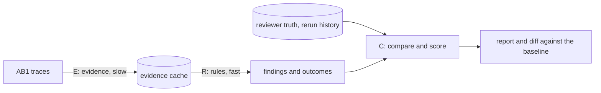

# Proposal: Evaluation method and fast feedback loop

## Problem

[PROP-0004](0004-review-triage.md) lets a rule act only after ground truth
has validated it. The lab has about 100,000 samples with raw traces and
reviewer results. Such a corpus can support strong claims, but only if two
things exist:

- **A method.** Fixed labels, splits, metrics, and reports, so that a number
  means the same thing in every run.
- **A fast loop.** Changing a threshold and seeing its effect must take
  seconds to minutes, not a day.

DNA is Rust and runs on a 256-core server. One run is not the bottleneck;
recomputing everything on every change is.

**Measured on 2026-10-14** (release build of main, one thread per process):

| Command | Wall time | Peak memory |
|---|---|---|
| `basecall` on one trace | 0.07 s | 5 MB |
| `analyze` on one trace | 1.9 s | 34 MB |
| `consensus` on one sample (4 traces) | 4.7 s | 52 MB |
| `sample` on the same sample | 4.6 s | 52 MB |

- **Placement dominates.** Reference placement takes about 95 % of the time.
- **Placement runs twice.** `sample` and `consensus` each place every trace
  again.
- **Scale.** 100,000 samples take about 130 CPU-hours per command. That is
  about 30 minutes on 256 cores at best, and today every rule change would
  repeat it.

## Goals

- **One method.** An evaluation method that defines labels, splits, metrics,
  and reports for detection, diagnosis, rerun, and per-rule approval.
- **Reproducible reports.** The same DNA revision, policy version, and dataset
  manifest always give the same report.
- **Loop budgets** on the server:

| Change | Scope | Budget |
|---|---|---|
| rule parameter or rule code | development panel | under 10 s |
| rule parameter or rule code | validation panel | under 1 min |
| evidence algorithm (DNA itself) | validation panel | under 10 min |
| any, before a release | full corpus | a scheduled run, not part of the loop |

## Non-goals

- Truth formats or comparison anywhere outside the harness crate. The `dna`
  binary and the plugin crates stay free of them.
- A review user interface.
- Biological rules. They are the subject of the loop, not of this proposal.

## Proposed design

### Three stages with a cache between them

- **Stage E (evidence).** Decoding, base calling, callability, placement, and
  consensus, per trace and per sample. This stage is expensive. Its output is
  cached under a key made of:
  - the SHA-256 of the trace bytes;
  - the evidence version (plugin versions, the hash of the evidence-relevant
    configuration, the reference checksum).

  Rule parameters are not part of the key, so a rule change never invalidates
  the cache.
- **Stage R (rules).** The pure rules of PROP-0004 run over cached evidence.
  They take microseconds to milliseconds per sample and run in parallel
  across samples.
- **Stage C (compare).** Outcomes are compared with the truth, then scored,
  reported, and diffed against a stored baseline run.

The loop then splits by what changed:

| What changed | Stages re-run |
|---|---|
| rule parameter or rule code | R and C only |
| DNA evidence code | E, R, and C |
| truth adjudication | C only |

### What DNA provides

The `dna` facade and the plugin crates stay free of truth and comparison. To
make the loop possible they provide:

- **Library calls.** A public call that computes a sample's triage evidence
  in process, and a separate call that runs the rule layer on such evidence
  (SRS-API).
- **An evidence record.** A versioned, serialisable record that holds exactly
  what the rules read, so a cache can store it. Whether this is a new compact
  record or the existing `dna.consensus` and `dna.sample_evidence` documents is
  open.
- **Placement once per trace.** One in-process call yields both the sample
  evidence and the consensus.
- **Faster placement.** Seed the placement with reference k-mers, then align
  in a band. Maintained implementations are evaluated first (SRS-NFR-006).
  This is a measured change: placements must stay identical on the corpus, or
  the changes must be explained.

### Where the harness lives

| Option | For | Against |
|---|---|---|
| **A. Separate Rust repository**, depending on DNA's crates by path or git revision | Keeps ADR-0065 and ADR-0066. Calls DNA in process with no process start or JSON parse per stage. Owns truth adapters, manifests, cache, the parallel runner, and reports. | DNA and the harness are versioned separately. Local work needs a path dependency on the DNA checkout. |
| **B. Crate in the DNA workspace** (chosen), outside the `dna` binary | One change spans both, and the loop is the tightest. | Brings lab truth formats and comparison into DNA, so it needs an ADR that supersedes ADR-0065. |
| **C. `mtdna_raw` (Python) drives the CLI** | Nothing new to build. | A process per sample, JSON on every stage, and every rule change re-runs the CLI, so the loop budgets cannot be met. |

### Evaluation method

**Truth and normalisation.**

- **What counts.** The reviewer variants of each sample, compared by the
  lab's concordance rules (primary measure), with a stricter measure on the
  truth's analysed intervals, an IUPAC-compatible measure, and haplotype
  measures that do not count a haplotype written or placed differently
  ([evaluation harness](../validation/evaluation-harness.md#measures)).
  Work is ranked on the haplotype measures, so representation does not
  inflate the error counts.
- **Notation.** The truth side is compared as stored in the database,
  following `comparison.py`'s rules; DNA's side uses its notation. The
  haplotype measures compare the sequences both notations describe instead.

**Labels.**

| Label | Definition |
|---|---|
| site error | false call, missed call, wrong allele, or wrong length at a truth site or DNA call |
| sample exact | no site error in the sample |
| error caught | the site lies inside an unreliable region or a region not passed |
| leak | a site error inside a passed region |
| rerun positive | a trace that the lab's rerun history replaced |
| rerun negative | a trace of a sample whose reviewed result needed no rerun |

The rerun history is the set of rerun lists that record which trace each
rerun replaced. The lab's own rerun decisions are noisy, so these labels are
a proxy.

**Metrics.**

| Area | Metrics |
|---|---|
| detection (stage 1) | leaks; passed-sample error rate with its Clopper–Pearson 95 % upper bound; burden as unreliable bases and flagged sites per sample; A/B/C at sample and region level |
| trade-off | risk–coverage curve: passed-sample error rate against A over a threshold sweep |
| diagnosis (stage 2) | confusion matrix of assigned against inspected cause, on an inspected sample of caught errors |
| rerun | precision and recall against the rerun history |
| per rule | unique catches, false flags, and the change in every metric when the rule is removed (ablation) |
| stability | samples whose outcome changed against the baseline, listed |

**Test panels.** The loop does not run on all 100,000 samples. It runs on
small, fixed panels, each with a manifest and its hash. A panel holds two
kinds of samples:

- **Anchors.** Samples whose result is exact and stays exact from run to run.
  They catch regressions: an anchor that changes is a failure to explain.
- **Problem samples.** Enriched by stratum, so each known difficulty has
  enough cases. Examples:
  - disagreement between the older pipeline and the truth;
  - IUPAC truth sites;
  - length variants in poly-C windows;
  - rare variants;
  - rerun history;
  - known DNA errors.

The panels:

| Panel | Size | Use |
|---|---|---|
| development | about 1,000–3,000 | every change, seconds |
| validation | about 10,000 | tuning and confirmation, minutes |
| hold-out | whole batches, including the most recent | rule approval only; never used to tune |
| full corpus | all samples with raw traces | scheduled release and drift runs |

Panel rules:

- **Deterministic selection.** Within each stratum, samples are taken in
  order of the hash of the sample id.
- **Weights.** Each stratum carries the inverse of its sampling share. The
  enriched panel can then still estimate corpus rates (A, error rate of
  passed results) without bias.
- **Refreshing.** A refresh adds a new manifest version and keeps the
  previous version runnable, so numbers stay comparable across versions.

**Panel v1 (built 2026-10-14, outside the repository).**

Inventory:

- the truth holds 103,418 samples;
- 97,306 of them have raw traces, and 96,841 have all of HV1, HV2, and HV3.

Each sample goes to the first stratum it matches. The strata use only
information that needs no DNA run, so their weights hold for the whole
corpus.

| Stratum (first match) | Corpus | Dev | Baseline not exact |
|---|---:|---:|---:|
| partial traces | 465 | 120 | 0.93 (mostly missing traces, not call errors) |
| reviewer flag or short range | 1,720 | 120 | 0.29 |
| HVS-I length variant | 462 | 150 | 0.60 |
| unusual HVS-II length | 1,196 | 150 | 0.17 |
| IUPAC truth site | 8,371 | 200 | 0.17 |
| rare variant | 351 | 150 | 0.22 |
| older pipeline disagrees, point | 6,582 | 200 | 0.30 |
| older pipeline disagrees, repeat window | 9,629 | 150 | 0.18 |
| resequenced | 4,018 | 150 | 0.25 |
| 309.2C | 12,263 | 150 | 0.23 |
| 16189C | 14,943 | 150 | 0.15 |
| clean | 37,306 | 300 | 0.01 |

What the strata show:

- **They separate difficulty.** Clean samples fail 1 % of the time; the
  enriched strata fail 15–60 %.
- **Corpus estimate.** Weighted, the baseline not-exact rate is 0.135 ± 0.016
  (95 %). Unweighted, the panel gives 0.258.

The panels:

- **Development panel.** 1,990 stratified samples, plus 630 earlier
  evaluation samples kept at zero weight.
- **Anchors.** Clean samples on which the older pipeline agrees with the
  truth. 294 of 297 were exact in the baseline. Two repeated runs gave
  identical results.
- **Validation and hold-out panel.** 115 whole batches with 10,109 samples:
  - all batches from the most recent reviewed weeks that were not used for
    tuning;
  - batches drawn by hash.

  It is not run until approval.

Measured run time for `consensus` plus `call`, about 6.3 CPU-seconds per
sample:

| Set | CPU-hours | 64 workers | 200 workers |
|---|---:|---:|---:|
| development (2,620) | 4.7 | 4.5 min (measured) | about 1.5 min |
| validation (10,109) | 18 | about 17 min | about 6 min |
| full traced corpus (97,306) | 175 | about 2.8 h | about 55 min |

**Faster placement (2026-10-14, PR #51, in review).** Four exact changes
keep every result byte-identical to the current release on 299 samples
(both `consensus` and `sample`) and on a separate check of 40 panel samples:

- a single-pass Gotoh kernel (about 4× per cell);
- seeded q-gram pruning that tolerates masked and mixed loci and crosses the
  circular origin;
- an orientation bound taken from the first orientation;
- selection instead of sorting for signal medians.

Results:

- **Fast tier usage.** Today 100 % of real reads fall back to full Gotoh in
  both orientations; with the prototype 96 % need none.
- **One sample** takes about 0.13 s instead of about 3.8 s on one thread.
- **Many samples.** One process with a thread pool reaches about 280–430
  samples per second on the shared server: about 25–40 s for 10,000 samples
  and 4–6 min for the full corpus.

The pruning change alters a proof (SRS-ALN-014) and needs scientific review
before it lands. With it, the validation panel fits the rule-change budget
even without the evidence cache. The cache still matters for the
seconds-scale development loop and for the full corpus.

Caveats:

- Strata built on the older pipeline inherit its biases.
- The truth is not certain.
- Some traces are copied into two batch folders. These copies are removed,
  but they weaken the batch hold-out.

**Statistical power.** With zero leaks in *n* passed samples, the 95 % upper
bound on the error rate is about 3/*n*. A panel can show which rule is
better. An absolute error-rate claim needs the hold-out or the full corpus:
10,000 hold-out samples with 60 % passed give about 0.05 %.

**Adjudication.** Every leak is inspected.

- A truth-origin case leaves the error count only with a recorded reason.
- A method-origin case goes on DNA's work list.
- The adjudication list is versioned with the harness.

**Report.** Every run reports:

- the DNA revision, policy version, and manifest hash;
- the stage timings;
- the summary metrics and the per-rule table;
- the list of leaks;
- the diff against the baseline.

The report is written both as machine-readable TSV/JSON and as Markdown.

### Validation of the harness itself

- **Byte-identical.** Running twice gives a byte-identical report.
- **Synthetic cases.** Synthetic cases with known labels cover every label
  and metric.
- **Known numbers.** On the 320-sample evaluation subset, the harness
  reproduces the numbers measured so far.

### Approval protocol (draft)

The harness implements this protocol as `dna-eval approve` and `dna-eval
power` ([approval](../validation/evaluation-harness.md#approval)); the bounds
and rules below are inputs of the pre-registration, which the tool checks.

This protocol approves pass rules on the hold-out (validation panel v3: 115
whole batches, 10,102 active samples, the same corpus weights as the
development panel). It is a draft; its bounds, utility floor, one-strand
rule, adjudication, and hold-out access were decided on 2026-10-16 (see
*Decisions of 2026-10-16* below).

**Freeze and pre-register.**
- **Pre-registration note.** Before any approval run, a pre-registration note
  is committed under `docs/validation/preregistration/` that fixes:
  - the DNA revision, `config/dna.toml`, the harness version, and the truth
    digest;
  - the exact policy: its detectors, the minor-signal kind and threshold, and
    the one-strand rule;
  - the measures, endpoints, bounds, and decision rule;
  - the expected number of passed samples.
- **One run.** The run happens once, and nothing is tuned after it. A rerun
  needs a new revision and a written reason.
- **Truth changes.** If the truth digest differs from the frozen one, the
  run aborts. The statistics database is refreshed often, so the
  pre-registration names a read-only copy of it with its SHA-256, and the
  approval run reads that copy.
- **A spent hold-out.** Once a rule is approved, the hold-out is spent for it.
  A later rule change needs fresh batches, such as those received after the
  freeze.
- **Readiness.** An approval run is pre-registered only when the development
  panel at the frozen revision makes it likely to pass: taking the policy's
  corpus-weighted development leak rate as the true rate, `dna-eval power`
  must give every gate a probability of at least 0.8 at the projected number
  of passes. A run on a rule bound to fail spends the hold-out without a
  decision.
- **Measurement fixes first.** Fixes that change what "concordant" means
  land before the freeze. These include DNA's callable intervals excluding
  unresolved consensus bases, and the haplotype measures deciding per
  interval.

**Rules under test.** The rules are tested as a fixed sequence, which keeps
the overall α without a Bonferroni split. A fixed sequence stops at the
first rule that fails; a rule tested after a failure would spend α again.

1. **H-base.** The stage-1 triage with the minor-signal gate (its kind and
   threshold are fixed at pre-registration), requiring both strands
   everywhere.
2. **H-os1**, tested only if H-base is approved. H-base plus the one-strand
   exception R6m-h4: one strand is enough outside the repeat windows ± 3 and
   away from reference runs of 4 or more bases. It is paired with a
   single-strand minor rule on the positions it allows, because the
   cross-strand minor rules cannot fire where only one strand reads.

R1 (an edge stretch of fewer than 5 positions read by one strand) is not
tested. It newly passes about 1 % of development samples, about 100 hold-out
samples, fewer than the 150 a 2 % marginal bound needs at 0 leaks, and
testing it after H-os1 fails would break the fixed sequence. Its leaks are
reported for the next development iteration.

**Endpoints.**

- **Primary safety: the leak rate among passed samples.** This is
  P(not concordant | pass) under the haplotype LoD measure, reported three
  ways, each with its upper bound. The delivered result carries the
  reviewers' IUPAC codes, so a truth heteroplasmy that a passed sample lacks
  is a leak where a covering read shows it at the limit of detection (10 %,
  see the decisions below); DNA reports none (SRS-VAR-009), so the triage
  must send such samples to review. Below the limit the code compares
  IUPAC-compatibly.
  - as a one-sided 95 % Clopper–Pearson bound on the unweighted passed
    samples;
  - as the corpus-weighted rate with a Korn–Graubard bound: a
    Clopper–Pearson bound on the effective sample size of the stratified
    variance. A normal-approximation bound is 0 when no passed sample leaks,
    so it cannot bound a rare rate;
  - as the 95th percentile of a cluster bootstrap over batches (10,000 draws,
    fixed seed), with fixed per-sample weights. Leaks cluster by batch,
    through chemistry, run, and reviewer. With no leak every draw is 0, so
    this bound adds information only when there are leaks; the gate needs all
    three.
- **Secondary safety, reported but not gating.**
  - The same rate under the primary, strict, IUPAC-compatible, haplotype,
    and haplotype IUPAC-compatible measures. The haplotype measure counts
    every missed truth heteroplasmy; the haplotype IUPAC-compatible measure
    separates base and length errors from missed heteroplasmy.
  - Leaks by window and by stratum.
  - A sensitivity analysis without the enriched strata.
- **Marginal one-strand endpoint** (H-os1). Among the samples a rule
  newly passes (passed by it, not by the hypothesis before it in the
  sequence), the share that leak anywhere under the primary safety
  endpoint's measure (haplotype LoD), with its Clopper–Pearson upper bound at
  sample level. Leaks inside and outside the positions it allows are
  reported apart.
- **Utility.** The corpus-weighted A with its interval; B and C are
  reported.

**Acceptance.**

| Rule | Approved when |
|---|---|
| H-base | all three upper bounds of the primary safety endpoint are at most 1 % |
| H-os1 | the rule still meets H-base's bound on all passed samples, its marginal upper bound is at most the bound fixed at pre-registration (2 %, 2.5 %, or 3 %; see below), and adjudication finds no leak class unseen on the development panel |
| any | the corpus-weighted A, as a point estimate, is at least 0.10 |

**Power.** With a one-sided 95 % Clopper–Pearson bound:
- **H-base.** A bound of 1 % needs 303 passed samples at 0 leaks, 474 at 1,
  630 at 2, 1,057 at 5, and 1,718 at 10. With an A near the development
  panel's, the hold-out should pass about 1,500–2,500 samples. That gives,
  for example, 0.52 % for 5 leaks in 2,000 passes.
- **H-os1.** It passes far fewer new samples. A bound of 2 % needs 150
  newly passed samples at 0 leaks, and 237 at 1.
- **Check at freeze time.** A power check from the development panel's pass
  counts and the hold-out's size is recorded in the pre-registration. For a
  marginal endpoint it records, as `projected_n`, the joint Korn–Graubard
  lower-bound projection of the samples the hypothesis newly passes over the
  one it is measured against, and where it came from; a bound that 0 leaks
  among those samples cannot meet stops the run.

**Adjudication in an approval run.**
- Every leak on the hold-out is inspected and classified as a DNA error, a
  truth error, a representation the measure missed, or ambiguous.
- Two senior lab reviewers, nominated by the user, classify each leak
  independently from the traces, DNA's call, and the truth, without being
  told which rule passed the sample. Neither may have reviewed that sample
  originally or have worked on the rules. They settle disagreements by
  discussion; a case they cannot settle is ambiguous. This follows the ISFG
  requirement of two scientists for a consensus haplotype and the blinding
  of reference assessors in STARD 2015 (items 13a and 13b).
- Unlike in development runs (see *Adjudication* above), the gating endpoint
  counts every leak, and no case leaves it after the run.
- The classification is reported next to the decision and feeds the next
  development iteration.
- Sample identifiers stay in the adjudication list, which is kept with the
  approval run's outputs under `results/` on the lab server, never in
  repository documents.

**Exclusions.** A sample DNA fails counts as not passed and is reported.

**Abstention.** The primary and haplotype measures count a truth allele where
DNA has no callable base (DNA abstains, `N`) as not compared, by the lab's
rule; only the strict measure counts it. The pre-registered policies must
therefore keep the `region.unreliable` cause `n`, so a passed region never
holds an abstention, and the strict measure is reported for passed samples.
The pre-registration fails if any policy drops `n`.

**Hold-out access.**
- The user is the hold-out's custodian and owns the approval decision.
- Nothing runs DNA or reads truth on the validation panel except the single
  pre-registered approval run, which the user starts. Development work,
  agent sessions included, uses the development panel only.
- `dna-eval run` refuses a validation manifest; only the approval command
  reads one, and only with a committed pre-registration.
- As of 2026-10-16 no DNA run on the validation panel exists; building the
  panel compared its batches with the database only.

**After approval.**
- **Monitoring.** A random 5 % of auto-passed production samples, at least
  50 a month, is reviewed as usual, without the reviewer knowing it was
  auto-passed. The cumulative leak rate is reported monthly with both
  Clopper–Pearson bounds.
- **Revalidation.** A change to DNA, its configuration, or the policy that
  changes any outcome on the development panel needs a new approval run on
  batches received after the previous freeze.
- **Stop rule.** Auto-pass is suspended when the cumulative one-sided 95 %
  lower bound exceeds the approved 1 %, which is evidence that the rate is
  above it, or at once when an adjudicated DNA error belongs to a class not
  seen in validation. An upper-bound trigger would suspend on the first leak
  for months while the audited count is small.

**Decisions of 2026-10-16.** The user decided that the delivered result
includes heteroplasmy (IUPAC codes) and delegated the other choices to
research; they are recorded here with their basis. Development-panel figures
are from revision 98ed11d with the haplotype measures of PR #57 and the
statistics database of 2026-10-16, unless stated otherwise; PR #59 leaves
the draft's outcomes unchanged.
- **Heteroplasmy counts (user decision).** The primary safety endpoint uses
  the haplotype measure, not its IUPAC-compatible form. On the development
  panel, with PRs #62 and #66, the draft policy leaks in 22 of its 458 passed
  samples under it (upper bound 6.8 %, corpus-weighted rate 3.3 %), and 21 of
  them only lack a truth IUPAC allele. No policy of the sweep comes close:
  the strictest minor-signal gate passes 239 samples (A = 0.094) and still
  leaks in 6 (upper bound 4.9 %). No rule is ready for an approval run;
  detecting heteroplasmy, or sending it to review, must improve about
  tenfold first.
- **Limit of detection, 10 % (user decision).** Sanger heteroplasmy
  detection is typically quoted at 10–20 % minor. Of the development truth
  IUPAC sites, 32 % show less than that in every covering read, including
  16189Y with no signal at all, which no trace-based method can reproduce.
  The primary safety endpoint therefore counts a missed truth heteroplasmy
  only where it is observed (`haplotype_lod`): the covering reads show both of
  the code's bases, each as some read's call or as a second channel at 10 %
  or more of a read's normalised profile, or one of them as such a second
  channel. The haplotype measure stays a secondary endpoint. On the development panel the draft policy then leaks in
  11 of its 458 passes (upper bound 3.9 %), and the draft's rule joined by
  `local_shadow@80` (PROP-0004) in 3 of 443 (upper bound 1.7 %): two
  heteroplasmies that one strand alone shows above the limit, and the truth
  numbering error below. At a limit of 5 % the development estimate would be
  about 2.7 times higher.
- **H-base bound, 1 %.** The draft policy passes 458 of 2,618 samples
  (A = 0.158 ± 0.022 corpus-weighted) with one haplotype IUPAC-compatible
  leak (upper bound 1.03 %). That leak is a truth numbering error: the truth
  writes six HVS-I and HVS-II variants one position before DNA, which writes
  a known haplogroup motif. The gate counts truth errors, so the bound must
  sit above the truth-error floor with margin. At about 1,600 hold-out passes
  and a true rate of 0.2 %, a 1 % bound is met with probability 0.998 (up to
  9 leaks), and a 0.5 % bound with probability 0.61 (up to 3 leaks), which
  would mostly test the truth rather than DNA. For comparison, 3 of 150
  profiles (2 %) in an EDNAP exercise held interpretation errors, besides
  clerical ones (Parson et al. 2004, *Forensic Sci. Int.* 139:215–226), and
  waivers of orthogonal confirmation in clinical sequencing ask for a 95 %
  lower bound on precision of about 95–99.8 % (Lincoln et al. 2019,
  *J. Mol. Diagn.* 21:318–329; AMP 2023, Crooks et al., *J. Mol. Diagn.*
  25:411–427). A 1 % bound on the leak rate is stricter than both.
- **Marginal bound, set by power at pre-registration.** R6m-h4 newly passes
  36 development samples (1.4 % unweighted, A + 0.022 corpus-weighted), about
  140–220 hold-out samples. That is too few for a 1 % bound even at 0 leaks
  (303 needed). Before the freeze, `dna-eval power` projects the newly passed
  count on the validation strata at the Korn–Graubard lower bound of the
  development newly-pass rate; the bound is the smallest of 2 %, 2.5 %, and 3 %
  that is met with probability at least 0.8 at a true rate of 0.2 %, and
  H-os1 is not pre-registered when none is. For example, 222 newly passed
  samples give 2.5 % (up to 1 leak, probability 0.93); 139 give none, since
  0 leaks already bound the rate at 2.13 %. The overall 1 % bound still holds
  on every passed sample.
- **Utility floor, 0.10 as a point estimate.** The floor only guards against
  approving a rule that passes too little to matter; safety is carried by
  the upper bounds, and a rule passing fewer than 303 samples fails them
  anyway. Judged on its lower bound, or at 0.15, the floor would fail the
  draft (A = 0.158, lower bound 0.136) for reasons unrelated to safety.
- **R6m-h4, not R6m.** A single strand miscounts homopolymer lengths (a
  missed `16193.1C` read cleanly by one strand on the development panel),
  homopolymer length variants are common outside the repeat windows (`249DEL`
  in about 28 % of corpus samples). The ISFG guidelines ask for forward and
  reverse sequence whenever practical, accepting same-strand replicates from
  different primers otherwise (Parson et al. 2014, *Forensic Sci. Int.
  Genet.* 13:134–142), and the SWGDAM guidelines of 2024 say both directions
  should be sequenced. R6m-h4 is narrower than a general single-strand
  exception, yet still departs from that practice, so it must earn approval
  on its own marginal endpoint. It keeps about two thirds of R6m's gain
  (+0.022 of +0.034 A on panel v4); its marginal bound follows the power
  rule above. R6m is not tested.
- **Monitoring at 5 %.** At about 10,000 samples a month and A near 0.16,
  this is about 80 reviews a month against about 1,600 saved. After three
  months (about 240 audited) the stop rule suspends with probability 0.72 if
  the true rate is 3 %, and 0.04 if it is 1 %.

## Alternatives considered

- **No cache; make DNA fast enough.** Rejected as the only path. Even a ten
  times faster placement re-runs about 13 CPU-hours for each threshold
  change. Faster placement is still worth having for evidence changes.
- **Score only exact samples.** Rejected. It hides where errors sit and
  cannot score a region or a rule.

## Rollout

1. **Inventory and panel v1.** Done, outside the repository (see *Panel
   v1*). The panel scripts move into the harness crate.
2. **Harness v0.** Comparison and the run are done (see *Implementation*):
   stage E calls DNA in process instead of reading CLI result JSON, and a
   draft stage R gives the phase-0 numbers of PROP-0004 (`run --triage`).
3. **DNA library calls and evidence record.** Placement once per trace.
4. **Placement speed-up.** PR #51, measured (see *Panel v1*); review and
   land it, then run a combined `sample` and `consensus` pass, share signal
   statistics between stages, and add a pipeline-level thread pool.

## Observability and operations

The harness logs stage timings, cache hit rates, and failures per sample.

## Security and privacy

The corpus holds lab and personal sample data. The harness and its reports
stay on the lab server under the [data policy](../governance/data.md). DNA
documents quote aggregates only.

## Compatibility and migration

DNA gains library calls and possibly an evidence record. Existing contracts
are unchanged unless the record reuses them.

## Open questions

1. Should the evidence record be a new compact contract, or the existing
   consensus and sample documents?
2. How much of the server may the loop use: all 256 cores, or a share?

## Decision

Decided 2026-10-14: the harness is a crate in the DNA workspace
(`crates/`), outside the `dna` binary (option B). This reverses the
earlier choice of a separate repository.

The crate landed with
[ADR-0075](../decisions/adr/0075-evaluation-harness-in-workspace.md), which
supersedes ADR-0065 in part, the matching revision of SRS-COMPAT-003, and the
crate-graph rule in `validate_module_layers.py`: the harness may depend on
`dna` and the plugin crates, and nothing may depend on the harness.

ADR-0066 is unaffected; the harness is Rust. The rest of the proposal is not
yet reviewed.

## Implementation

- **Placement once per trace** (rollout step 3, SRS-API-009..011):
  `dna::sample_analysis::analyze_sanger` returns the typed sample evidence and
  consensus from one placement pass; `sample` and `consensus` run the same
  pass. The evidence record (open question 1) is not decided.
- **Rollout step 4:** signal statistics are shared between the windowed
  features and the locus contexts, and a sample's reads run concurrently
  with the operation log kept in trace order. On 2,618 development-panel
  samples every `consensus` and `sample` output is byte-identical to the
  previous release.

**Harness v0** (`crates/dna-eval`,
[evaluation harness](../validation/evaluation-harness.md)):

- **Scope.** It runs DNA, compares the calls with reviewer truth, and
  reports weighted estimates, anchors, and the diff against a baseline run.
  The evidence cache and rerun labels are not built yet.
- **Draft stage R** (`run --triage`, 2026-10-15). Draft stage-1 detectors of
  PROP-0004 over a compact per-sample evidence record taken in stage E and
  held in memory; every policy of a sweep runs on that record without DNA.
  Results and timings are in
  [PROP-0004](0004-review-triage.md#phase-0-results).
- **Stage E.** Instead of reading CLI result JSON (rollout step 2), it calls
  the library: `dna::sample_analysis::analyze_sanger` with one worker per
  sample, then `SampleAnalysis::call`, which completes `consensus` then `call`
  in process; the harness runs samples on its own scoped thread pool.
- **Truth.** The lab's statistics database (`statistics.sqlite`, read-only
  through `rusqlite`), the indexed copy of the merged reviewer results; it is
  the harness's single truth source.
- **Comparison.** It adapts the lab's comparison rules (`mtdna_raw`
  `comparison.py`), DNA as the automated tool A and the truth as tool B, as
  the primary measure. A strict measure also counts truth alleles inside the
  truth's analysed intervals where DNA has no callable base, and an
  IUPAC-compatible measure lets DNA's base match a truth IUPAC code that
  admits it. The haplotype and haplotype IUPAC-compatible measures apply
  those rules only to alleles that do not describe the same sequence (see
  *Haplotype measures* below). This replaces the panel's research scoring
  ("fair scale"); the differences of the primary measure:
  - the research scoring kept only tokens inside the truth's analysed
    intervals on both sides; the lab's rules count every DNA-only allele in
    HV1–HV3, and a truth-only allele only inside DNA's callable intervals;
  - the research scoring left out every token at a truth IUPAC position; the
    lab's rules compare IUPAC alleles like any other, so DNA's major-allele
    call is discordant;
  - the lab's rules leave out insertions and deletions at 309, 455, 463, and
    573 and never compare 309.1, 309.2, and 573.1;
  - the lab's rules key an allele by position, reference, and alternate, so a
    truth reference that differs from rCRS (25 truth rows) is a difference;
  - an empty side is `N/A` rather than exact; insertions belong to their
    anchor base.
- **Panel v2** (`dna-eval panel`, 2026-10-15). It keeps every v1 row and
  names the statistics database and its SHA-256 as the truth. Samples the
  database lacks are retired and left out of the estimates; their strata share
  the stratum weight among the remaining samples. Dev: 2,620 rows, 2 retired.
  Validation: 10,109 rows, 7 retired. No batch differs from the database. The
  v1 files are unchanged.
- **Panel v3** (`dna-eval panel`, 2026-10-15). It adds each sample's truth
  digest and the panel truth digest, so a database refresh that changes no
  panel sample needs no new version; a run lists the samples whose truth
  changed and marks itself `truth changed` otherwise. Dev and validation keep
  the v2 rows and weights; v1 and v2 files are unchanged. On dev v3 every
  per-sample result equals the v2 run.
- **Dev panel v2** (2026-10-15, revision 56424be plus this change; the
  same per-sample results as on revision 348cf13 before the one-pass sample
  analysis, and as on the database refresh of 2026-10-14 17:31, which changed
  no panel allele):
  - **Panel against the truth.** The 2,618 active samples have the same
    alleles as in the truth file v1 was built from; 2 are not `OK` in their
    batch.
  - **Primary.** 1,958 `Y`, 656 `N`, 2 `N/A`, 4 failed (2 traces too short
    for signal processing, 2 retired without truth). Corpus-weighted
    not-concordant rate 0.1783 ± 0.0138 (95 %), unweighted 0.2852. 295 of 297
    anchor candidates are concordant.
  - **Strict.** 1,818 `Y`, 796 `N`; rate 0.2061 ± 0.0152. 201 samples have
    666 truth alleles where DNA has no callable base, and 140 samples
    concordant on the primary measure are not on the strict one; partial
    traces go from 0.375 to 0.933 not concordant.
  - **IUPAC-compatible.** 2,219 `Y`, 395 `N`; rate 0.1013 ± 0.0143. It
    turns exactly the 261 samples whose primary discordance lies only at
    truth IUPAC alleles concordant; the IUPAC stratum goes from 1.000 to
    0.130.
  - **Against the research baseline** (0.1350 ± 0.0159 not exact): 278
    exact samples are discordant, 247 of them only at truth IUPAC alleles (the
    whole IUPAC stratum is discordant) and 29 at DNA alleles outside the
    truth's analysed intervals. 172 not-exact samples are concordant: 107
    differ only at truth alleles outside DNA's callable intervals, 32 only at
    special-position indels, and 33 at both.
  - **Same rules as the lab's code.** Run through `SampleComparator` on the
    same DNA calls and truth, every one of the 2,616 compared samples gets the
    same `Y`, `N`, or `N/A` on the primary measure.
- **Dev panel v3 after the too-short rejection** (revision d171ce3 plus this
  change, truth unchanged): the 2 samples that failed on a trace too short
  for signal processing now set that trace aside and are concordant on all
  three measures; no other sample changes. Primary 1,960 `Y`, 656 `N`, 2
  `N/A`, 2 failed (the retired samples), rate 0.1779 ± 0.0138; strict 1,820
  `Y`, rate 0.2057 ± 0.0152; IUPAC-compatible 2,221 `Y`, rate 0.1010 ±
  0.0143.
- **Haplotype measures** (2026-10-15, revision a244644 plus this change, dev
  panel v3 on the database refresh of 09:53, which removed the truth of one
  zero-weight sample; every primary, strict, and IUPAC-compatible result and
  estimate equals the draft-triage run before this change, and no sample
  concordant on a base measure is discordant on its haplotype measure).
  - **Method**
    ([measures](../validation/evaluation-harness.md#measures)). Inside the
    HV regions within DNA's callable intervals each side's alleles are
    applied to rCRS and the two sequences are cut into blocks wherever their
    lengths agree; alleles outside differing blocks leave the comparison, and
    the base rules decide the rest. Special-position indel lengths, which the
    rules leave out, cannot decide a block (each interval is also built with
    both sides' special-position indels the same), and the IUPAC leniency is
    the base measure's, so only representation changes a status. Comparing
    notations after DNA's own normalization and nomenclature was rejected:
    `dna-post` rejects IUPAC codes and truth references that differ from
    rCRS, and its windows give a canonical form only for the forms their
    rules know, so equivalent truth forms such as `16190T 16193.1C 16193.2C`
    against `16188.1C 16188.2T` would stay different. `dna-post` is the test
    oracle instead: for every single-base edit around the HVS-II and HVS-III
    windows, its normalized and represented calls are one sequence under the
    measure, and two edits are one sequence exactly when `dna-post` rebuilds
    the same haplotype.
  - **Review fixes** (special-position balancing, the IUPAC leniency limited
    to truth-written symbols, alleles spanning several reference bases),
    re-measured on the next database refresh, which gave the two retired
    samples a record again: every other sample has the same status and
    discordant positions on all five measures, and every estimate is equal.
    On this panel no DNA call is an IUPAC code, no truth allele spans several
    bases, and no placement depends on the special-position balancing; the
    fixes guard the measure rather than move it.
  - **Haplotype.** 2,020 `Y`, 595 `N`; corpus-weighted not-concordant rate
    0.1753 ± 0.0137 (primary 0.1779), unweighted 0.2550 (0.2842). 60 of the
    655 primary-discordant samples describe the truth's sequence: 50 in the
    HVS-I poly-C window, 7 in HVS-II, 2 in the AC repeat (one with `248DEL`
    against `249DEL`), and 1 at `455.1T 459DEL` against `456T`; the HVS-I
    length stratum goes from 0.580 to 0.267. The most frequent form is
    `16188.1C 16188.2T` against `16190T 16193.1C 16193.2C` (19 samples).
  - **Haplotype IUPAC-compatible.** 2,301 `Y`, 314 `N`; rate 0.0977 ± 0.0143
    (IUPAC-compatible 0.1010), unweighted 0.1469 (0.1861): 80 of the 394
    IUPAC-compatible-discordant samples, the 60 above and 20 whose placement
    also involves a truth IUPAC code (`16190.1T` against `16191Y 16193.1C`).
    The HVS-I length stratum goes to 0.133. Anchors: 295 of 297 concordant
    on both haplotype measures, as on the primary.
  - **What remains** (314 samples, by the blocks where the sequences
    differ): HVS-II poly-C, DNA's sequence shorter (129 samples, mostly a
    truth `315.1C` DNA lacks, usually with a shorter 303–309 run as well);
    substitutions outside the repeat windows (59); HVS-I poly-C
    substitutions DNA does not call (44: `16189C`, `16183C`, `16184A`);
    blocks outside the truth's analysed intervals, where only DNA calls
    (HVS-II 32, other 12, HVS-III 6, AC repeat 1); HVS-I poly-C length (13
    shorter, 10 longer); AC repeat (11 substitutions, 8 longer, 5 shorter);
    other length differences (9 shorter, 7 longer); and fewer than 8 each in
    the HVS-II and HVS-III windows. 209 blocks are open at a callable-interval
    end.
- **Speed.** The dev panel takes 5.5–7 s wall on 64 or 128 threads of the
  shared server (about 320–800 CPU-seconds, with the one-pass sample analysis
  at the low end); a first run under a load spike took 20 s.
- **Determinism.** Every output except the timed `run.json` is
  byte-identical between 64 and 128 threads.
